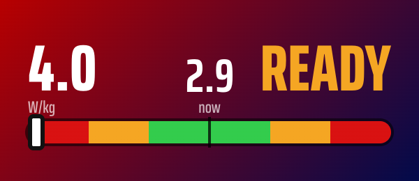
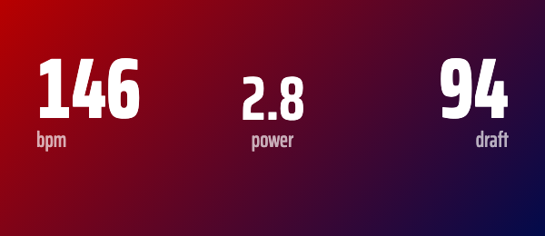
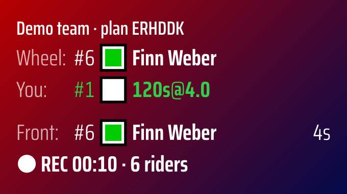
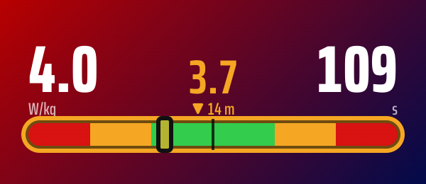
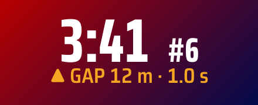
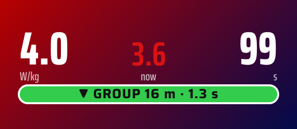

# Paceline 0.3.4

Paceline is a mod for Sauce for Zwift that helps our team time trial. It:

1. Loads the team's TTT plan and shows you the plan code, so we know everyone has the same plan.
2. Shows who is pulling, whose wheel you are on and how long until your pull, and during your
   pull your target watts, the time left and a power bar (new in 0.2).
3. Records how the team rides together (who is near you, power, speed, positions) while you ride.

Paceline doesn't calculate plans. The rotation, pull times and pull watts come from the
[ZwiftGopher TTT planner](https://zwiftgopher.com/TTT/), which does all the maths; Paceline
carries its plan into the ride.

Your captain uploads the plan to the plan server for your club, and Paceline gets it from there
when you are in the race (see "Load the plan"). Paceline records the ride on your computer. You
can export a recording and send it yourself, or tick **Upload my recordings after each ride**:
then each finished recording goes to the plan server, where only the Paceline operator opens it,
to analyse your team's rides. The server doesn't analyse recordings automatically yet.

**0.3 and the plan server.** Paceline 0.3 gets its plans from the plan server
(`https://ttt.mafl.net`): your captain registers the club there and uploads the plans there. It is
a new server: nothing from 0.2 is carried over, so the captain registers the club again. The
captain gets the club link by mail: open it within 24 hours; from then on it is the club's link for
good. Bookmark it or keep the mail: it opens the club on any device, until a new link is asked for
with "Lost link". Paceline
0.3 talks only to this new server, and 0.2 gets only "Update Paceline" from it, so update before
your next race. Coming from 0.2, a plan you loaded there no longer counts while the plan server is
on, and recordings made with 0.2 stay on your computer (export them to send them). The server
address is under **Advanced**, **Server**: leave it as it is, unless your club uses another server.
An address you type there is kept; otherwise each build uses its own server. Betas (`0.3.x-beta.N`)
talk to the beta plan server (`https://ttt-beta.mafl.net`), which has its own clubs and plans.

  
  

  
  

  
  

  
  

  
  
  

  
  
  

*Top: the Action window while resting (time to your pull, your place in the line) and during your
pull (target, time left, power bar). Middle: the Action window when the Rest window has the
countdown, with READY shortly before your pull, and the Rest window. Next the Action window's
fields while resting (new in 0.3.4-beta.3; see "Fields while resting") and the settings that
switch them on. Then the Info
window, for riders and in captain mode with the rotation table (one rider dropped, below the line). Bottom: a gap in the line, first
a gap opening behind you during your pull (early stage), then the group lost your wheel, and you
lost the wheel while resting. Last row: the same three in green, the gap is getting smaller (new
in 0.3.0). Demo data with made-up riders.*

## Install

You need Sauce for Zwift already installed and working.

1. In Sauce, open **Settings**, then **Mods**, and press **Open unpacked SauceMods folder**.
   This opens the right folder for you, also when you use OneDrive or a translated
   "Documents" name. If you cannot find that button, the folder is normally:
   - macOS: `~/Documents/SauceMods`
   - Windows: `%USERPROFILE%\Documents\SauceMods` (with OneDrive it may be
     `OneDrive\Documents\SauceMods` instead)

   If the `SauceMods` folder does not exist yet, create it.
2. Download the newest `paceline-<version>.zip` (for example `paceline-0.3.3.zip`) from the
   [latest release](https://github.com/mafl2k/paceline/releases/latest), under **Assets**. A beta
   such as `paceline-0.3.4-beta.5.zip` is not the latest release: it is on the
   [releases page](https://github.com/mafl2k/paceline/releases), marked **Pre-release**.
   Put the `paceline` folder from the zip into that folder. When updating, replace the old
   `paceline` folder completely; your plans and recordings are kept.
   - macOS: double-click the zip, then move the `paceline` folder into `SauceMods`.
   - Windows: open the zip and drag the `paceline` folder into `SauceMods`. If you use
     **Extract All** instead, change the destination to the `SauceMods` folder itself and
     remove the proposed `paceline-<version>` from the end of the path. Otherwise you get
     `SauceMods\paceline-<version>\paceline\manifest.json`, and Sauce silently ignores that.
3. Check that this file exists: `SauceMods/paceline/manifest.json`. The `paceline` folder must
   sit directly inside `SauceMods` and contain `manifest.json` itself. Not
   `SauceMods/paceline/paceline/manifest.json`, and not `SauceMods/paceline-<version>/...`: Sauce
   does not find those.
4. Quit Sauce completely and start it again. Sauce only looks for new mods when it starts.
5. On that start Sauce asks **New Sauce MOD Found**. Press **Enable Now**. Sauce then restarts
   by itself after about 4 seconds; wait for it. (If you pressed Ignore, enable **Paceline** in
   Settings, then **Mods**, and restart Sauce once more.) Updating from 0.1.0: replace the
   folder, restart Sauce, skip to step 6. Sauce does not show "New Sauce MOD Found" then.
6. Add the windows: in Sauce's window list, open **Paceline Info** (a small status box) and
   **Paceline Action** (the big countdown and pull display). Optionally also **Paceline Rest**
   (only the countdown, see below). Outside a TTT event they are invisible: click where one
   sits to open the settings window, and press **Start demo** there to see them. If you had Paceline 0.1.0 open,
   that window is now **Paceline Info**. If the Paceline Info window looks cramped after
   updating, drag it bigger (about 340×190).

**Sauce mod store.** From its first store release Paceline is also in the Sauce mod store
(Sauce's **Settings**, then **Mods**), and a store install updates by itself when Sauce starts.
Switching from a folder install to the store means adding the windows again; your plans,
Paceline's preferences and recordings stay (each window's appearance settings start fresh). After
switching, remove the old `paceline` folder from `SauceMods` (or disable that copy in Sauce's
**Mods** settings) and restart Sauce, so the windows don't come twice. (Betas are not in the store: they come as a zip from the
[releases page](https://github.com/mafl2k/paceline/releases).)

## Load the plan

Nothing to load by hand: your captain uploads the plan to the plan server for your club, and
Paceline gets it when you are in the race.

1. Click a Paceline window (outside a TTT event it is invisible: click where it sits, or
   right-click it and press the tune icon in Sauce's title bar). This opens the Paceline settings window.
2. Under **Clubs**, check that your club is ticked. The first time, Paceline asks the plan server
   which clubs list your Zwift ID (Zwift must have run once, so Paceline knows it), and ticks the
   first club that lists you by itself. If the table says "No club lists you yet. Your Zwift ID is
   …: send it to your captain.", do that.
3. Under **Plan**, a line says what waits for you, for example "Next: Rollers fast, Thu 19 Nov
   19:30": the next race with a plan listing you, in a club you ticked.
4. In the race the plan arrives by itself. The status line then says "Rollers fast · F9E98R ·
   Kettenfett RC · checked 19:02" (plan, plan code, club, last check) and the plan shows under
   **Plan**. Check the plan code as described below.

*The settings window below "All Paceline windows": the plan server box with what Paceline sends,
the server plan of Kettenfett RC with its code and riders, and the Clubs table. Made-up clubs and
riders.*

### Clubs

The Clubs table lists the clubs whose plans have your Zwift ID. Paceline takes plans only from
ticked clubs. Tick the club you ride for, and leave a club you don't know unticked.

- A row shows "lists you" while the club has a plan with your Zwift ID, and "your club since
  12 Nov" once you ticked it.
- Only the first club is ticked by itself, and only while the table is empty. Clubs that come
  later show up unticked and have no effect until you tick them. If two clubs list you at once,
  none is ticked and the table says "Several clubs list you. Tick yours." (In a race, Paceline
  ticks the club that has the plan for it.)
- Ticking and unticking apply at once, also during a ride.
- **Private clubs.** A club can be private: then the plan server doesn't show it to anyone without
  its code, and it is never ticked by itself. Your captain gives you the code (10 letters and
  digits, like `7Q4MZ-2KX9B`). Type it under **Add club by code** and press **Add**; case, spaces
  and hyphens don't matter. The club is then added, ticked, and its row shows "private · code
  7Q4MZ-2KX9B", so you can pass the code on to a teammate. Messages:
  - "A club code has 10 letters and digits.": a typo.
  - "No club has this code. Check it with your captain.": nothing is stored.
  - "Too many wrong codes from your network. Try again in an hour."
  - In the row, "this code no longer works: ask your captain for the new one" (the captain made a
    new code), or "private now: enter its code below" (an open club you ticked became private).

### When Paceline checks

Under **Get plans from the plan server** the settings window says what goes to the server:

> When you are in a Zwift event, and when you open these settings, Paceline sends the plan server
> your Zwift ID, the clubs you ticked, the codes of private clubs you added, your event's start
> time and id, your plan code and the Paceline version. A club you ticked sees when you last
> checked.

- **In a Zwift event.** A Paceline window must be open: one of them asks the server, at once when
  the event begins, then every 10 seconds while there is no plan for this event yet, else every
  minute. When the server does not answer properly (it is busy, or unreachable), Paceline waits
  longer after each failed check: 10, 20, 40, then 60 seconds
  (new in 0.3.4-beta.4). With **Only during TTT events** (the default) only a TTT
  counts; unticked, any Zwift event does. A team ride outside any Zwift event gets no plan from the
  server: load the file (below).
- **The plan opens 30 minutes before the start.** The server sends a plan only from 30 minutes
  before the team's start time the captain set. Until then the Info window and the settings say
  "Plan opens 19:00 · Rollers fast", and Paceline keeps checking every 10 seconds, so the plan
  arrives within 10 seconds after that time.
- **When the settings window opens** it checks once. That fills the Clubs table and the "Next:"
  line, but never makes a plan active.
- **Nothing else checks.** Outside events (and with the settings window closed) Paceline doesn't
  ask the server at all.
- A server plan from an earlier race is not shown in a new event until this event's answer has
  arrived. When the server has no plan for you in this race, the settings say "No plan for you in
  this race yet." and the old server plan goes away (unless the ride lock below holds it).
- When the captain uploads a changed plan, Paceline switches to it within a minute, also during
  the race (the rider pulling keeps his clock).
- If the server cannot be reached, Paceline keeps the plan it has; the settings window shows the
  error, the overlay windows do not. If that lasts, load the files yourself (below).
- When a club you haven't ticked has a plan for you in this race and no ticked club has one, the
  Info window says, once per club, "Spokesmen CC has a plan for you in this race. Click, then
  tick it under Clubs."

### Two clubs and the teammates in the pen

If two clubs you ticked both have a plan with you as a rider in the same race, the teammates near
you decide; you don't pick. For each plan Paceline counts its riders (not the planner's roster) in Sauce's
list of riders near you:

- In the start pen, as soon as one plan has 2 or more riders more than the other, it is taken. It
  can still change while riders come and go. Until then the newest upload is active.
- At the roll-off the plan with the most riders near you wins, on a tie the newest upload. The
  ride lock then keeps it.
- Without data on riders near you, the newest upload wins.

The settings status then adds "2 clubs fit: picked by the teammates near you". With two or more
clubs ticked, the Info window's plan line also names the club (`Rollers fast · plan F9E98R ·
Kettenfett RC`).

### The ride lock

From your roll-off until the event ends, Paceline keeps the team whose plan was active at the
roll-off:

- A new plan for that team (the captain fixed something) applies at once.
- Another team's plan, or "no plan", waits until the event is over.
- What you do yourself applies at once: loading a file, **Remove**, ticking a club. Unticking the
  locked club ends the lock and its plan.
- With no server plan at the roll-off (none yet, a failed check, or a file plan), the lock binds
  to the first server plan that arrives during the ride. It never binds to a file plan.
- In the start pen and outside events there is no lock.

### Pull targets from the plan

The plan's JSON export has, for each rider, the pull watts (`pull_power`) and the target in W/kg
(`pull_wkg`), the number on the plan image the captain reads out.

- **Watts** come from the JSON, else from the text export, else there are none. When both files
  have them and they differ, the JSON wins (it matches riders by Zwift ID, the text only by name),
  and the import warns: "Pull watts for Ben differ between the files – using the JSON."
- **W/kg** (the default target unit) is the plan's `pull_wkg` for every rider, you included,
  shown with one decimal like Sauce. It is not worked out from watts and weight. Only for a plan
  without `pull_wkg` Paceline divides the watts by the weight, as before.
- A rider with W/kg but no watts gets no target.
- The plan code covers the watts, not the W/kg, so a plan's code stays the same with or without
  `pull_wkg`.

### Load a plan from a file instead

A plan from a file overrides the plan server. Use it when the server is down, or for a team ride
outside a Zwift event.

The captain gives you the files from the [ZwiftGopher TTT planner](https://zwiftgopher.com/TTT/):
the **JSON export**, and if it has no pull watts, the **text export** too. The JSON has the Zwift
IDs and, from the planner's newer exports, the pull watts and W/kg; the text export has the pull
watts.

1. Click a Paceline window (outside a TTT event it is invisible: click where it sits, or
   right-click it and press the tune icon in Sauce's title bar). This opens the Paceline settings window.
2. Under **Plan**, open **Load a plan from a file instead** and drop the files into the box, or
   press **Choose files…**. (There is also **Paste instead** if you have the file contents as
   text.) With the plan server switched off the box is open already.
3. You should now see the team name, the riders table and a line "You are *your name* · #position ·
   60s@4.4" (your pull time and target in W/kg, or in watts with that setting). Until Zwift is
   running with your rider, that line says "Waiting for Zwift…" instead. That is normal: the plan
   code check below works without Zwift. Once Zwift runs and you are not in the plan ("You are not
   in this plan", also when you are only in the planner's roster), tell the captain.
4. Check the **Plan code**. It is 6 characters long, and everyone on the team must see the same
   code. Compare it with the captain's. If yours is different, you have a different or older plan
   file: load the files again, and ask the captain to resend them if the code still differs.

While the file plan is active, the settings say "Plan from file, not from the server", with
**Remove**. Paceline still checks the server (for the Clubs table and what waits), but its plans
wait. A file plan ends when the first event after you loaded it is over (for a TTT, 30 seconds
after the finish), or 18 hours after you loaded it, whichever comes first; **Remove** ends it at
once, and the server's plan for this race, if there is one, takes over. With the plan server
switched off (untick **Get plans from the plan server**) a file plan never ends by itself.

Press **Done** to close the settings window.

## During the ride

**Only during TTT events.** Paceline stays quiet until you join a team time trial in Zwift
(Zwift's event type, WTRL's TTT tags, or "TTT" or "Team Time Trial" in the event's name, for
private TTTs; new in 0.2.31): the Action, Rest and Info windows are invisible (nothing shows, not
even their background), nothing records and the plan server is not asked (only the settings window
checks once when you open it). They appear when you enter the start pen, and go invisible again 30
seconds after the finish. To find a window while it is invisible, move the mouse over where it
sits (with a Transparent theme its outline and background show then, not with a solid background).
To move or resize it, right-click there (Sauce's settings mode shows its title bar), or press **Start demo** in the settings window,
which shows all windows. To use Paceline outside a TTT event (a team practice ride, or if Zwift ever changes
how it marks TTT events), untick **Only during TTT events** in the settings window.

**Paceline Action** is the window to glance at while riding. Its numbers are big and narrow
(bold, in Sauce's own font), so they use the window's height as well as its width: make the window
taller or wider and they grow (new in 0.3.4-beta.3):

- While you rest it shows one big clock: the time until your pull starts, in seconds as pulls
  are called (`26s`), above 100 seconds as minutes (`5:47`). It adds up the planned pulls of the
  riders before you, the rider at the front included, plus how much longer your team's turns take
  than planned (new in 0.3.4-beta.5). Paceline learns that during the race, from one rider's ease-off
  to the next rider's, over the last 12 normal turns, and starts learning 2 minutes after the
  roll-off. Until then, and as a starting value, it counts 10 seconds per rider (5 seconds for a
  pull over 40 seconds); in our races a turn took 2 to 11 seconds longer than planned. One turn
  counts at most 10 seconds over or under the plan, so a single odd turn cannot swing the clock;
  the learned value is used from the third learned turn on, and it stays within 10 seconds of the
  starting value (10 seconds, or 5 seconds for a pull over 40 seconds). The rider
  directly before you counts that extra time minus the changeover itself (also learned, about 5
  seconds to start with), so the clock reaches 0 when he eases off. READY covers the
  time until he swings off. The clock
  simply runs down at a normal change, without a jump when the next rider takes over. The
  countdown is only good to about 10 seconds (riders pull longer or shorter than planned); the
  handover itself is called out by voice. When the rider at the front has pulled his plan plus
  that extra time, the countdown runs on for 3 more seconds (the time Paceline needs to see the
  change) and then waits until the next rider is at the front, so it does not run out while
  someone pulls longer. While it waits it says so: the number is dimmed with a `≥` in front
  (`≥27s`: your pull is at least that far away), and under it, small, how long the rider in front
  is over his plan (`+14`). When the change comes it runs on as usual.
  When the race does not go as planned (a rider swings off early, drops out of the line or comes
  back), the clock corrects itself without jumping where it can. A few seconds it simply runs a
  little faster or slower until it is right. A bigger change it takes at once, softly faded in,
  and the line under it says why for 5 seconds: `ELI out −40s` (amber: your pull comes sooner) or
  `ELI back +1:10` (dim: later), or just the amount (`−25s`) when no rider explains it. A change to
  later waits 3 seconds first, so a short shuffle at the front never moves the clock. In the last
  15 seconds the clock is always exact; if READY was on and the pull moves away again, it says
  `READY off +36s`.
  Right of the clock is your place in the line right now, counted in plan order from the rider
  who is pulling (`#1`): `#2` means you are next.
- **READY:** in the last 10 seconds before your pull the window shows three fixed points, each
  with a small label under it: your target on the left (`4.0`, `W/kg`), your power now small in
  the middle (`3.1`, `now`), and `READY` in amber on the right. The power bar is there already,
  its marker white: it shows where you are against the target, so you come up to it before the
  handover instead of surging (being below it in the draft is right, so nothing turns red yet).
  The middle number is drawn smaller than the two at the sides (see **Smaller middle field**
  below).
- **During your pull** the same three points: your target on the left, your power now in the
  middle, the time left of your pull in seconds on the right (`110`, `s`; amber in the last 10
  seconds, over time it runs on below zero in amber, `−4`). Below is the power
  bar: the middle line is your target, green is within 5 % of it, amber within 10 %, red beyond.
  The marker is your filtered power: single spikes in Zwift's power are thrown out, the rest is
  smoothed over a few seconds, and the marker only moves once that is more than 2 % (about 5 W)
  away from where it stands. So it keeps still while you ride on target, and a real drop of 10 %
  shows after about 4 seconds. Its colour is the zone it is in. In the first seconds of your pull,
  while you ramp up, the marker stays white. The number in the middle is the marker's value (the
  same filtered power, so they always agree), in the marker's colour; kept small on purpose, so the
  bar stays what you ride by and the number only confirms it. Without pull watts in the plan
  (neither in the JSON nor from a text export) there is no target, so you see `–` as the target,
  your power now, the time and a plain grey bar.
- **Smaller middle field** (new in 0.3.4-beta.3): the middle number, your power now in READY and
  during your pull (and the middle field while resting, see below), is drawn a little smaller
  than the two at the sides, so the target and the time stand out and the bar stays what you
  ride by. To have all three numbers the same size,
  untick **Smaller middle field** in the Action window's settings (under "This window"). It is on
  by default.
- **Fields while resting** (new in 0.3.4-beta.3, off by default). While a Rest window is open it has
  the countdown (once it shows one), and the Action window stays empty while you rest. If you would rather have
  numbers there, tick **Fields while resting (when a Rest window is open)** in the Action window's
  settings. The window then shows three fields while you rest, laid out like your pull (left,
  middle, right, each with its unit under it), and you pick what each one shows:

  | Choice | Shows | Unit line |
  |---|---|---|
  | **Off** | an empty field, it keeps its place | |
  | **Power now** | your power as in your pull: W/kg or W as you set **Pull target**, smoothed the same way | `power` |
  | **Power W** | your power in whole watts | `W` |
  | **Power W/kg** | your power with one decimal | `W/kg` |
  | **Draft** | the watts of your draft, whole number | `draft` |
  | **Speed** | km/h, no decimals | `km/h` |
  | **Cadence** | your cadence, whole number | `rpm` |
  | **Heart rate** | your heart rate, whole number | `bpm` |
  | **Grade** | one decimal, `0.0` for flat | `%` |

  By default the middle field is **Power now** and the left and right ones are **Off**, so the
  number does not change its kind or jump when your pull starts. **Power W** and **Power W/kg**
  are your power right now; tick **5 s smoothed power** for the average of the last 5 seconds
  (**Power now** is smoothed as in your pull and ignores it). A value Paceline does not have, for
  example no heart rate or cadence from a power-only trainer, or no weight for W/kg, shows a dim
  `–`. There is no countdown to pick: that is the Rest window's. The fields show until READY, the
  last 10 seconds before your pull, and from then on the window shows READY and your pull as
  always. A climb or descent (the Rest window shows `▲` or `▼`) does not change them: they keep
  showing live values. They only show while a Rest window shows the countdown (or a dash in its place):
  with none open, or one that has no countdown yet, the Action window shows
  the countdown and your place as always, whatever you picked, and when you close the Rest window
  it shows the countdown again at once. The one exception is when the order breaks (see "When the
  order breaks"): then there is no countdown to show, so the fields show while you rest, with or
  without a Rest window: the ones you picked if **Fields while resting** is ticked, otherwise
  just your power now in the middle. (The Rest window shows the countdown only, never the fields.)
- **A gap in the line** (new in 0.2.28). Paceline watches the distance from each team rider to
  the rider ahead of him. When it is 10 m or more for 5 seconds (15 m on a real climb or
  descent), someone has lost the wheel; the warning ends when the gap has been under 6 m for 3
  seconds. The distance is measured where the line breaks, from the rider ahead of the gap to the
  first one behind it, and shown in metres and in seconds at your speed (`16 m · 1.3 s`). In the
  three recorded races of 12 Nov 2026 this caught every rider who dropped and stayed quiet
  otherwise (4 to 6 warnings a race).
  - **Early stage** (new in 0.2.29): the draft starts to fade from about 6 m (in those races a
    rider got about 31 % of his power from the draft up to 5 m, 22 % at 8 m, 14 % at 10 m, none
    from 15 m). From 8 m for 5 seconds (12 m on a real climb or descent) your power bar gets an
    amber edge during your pull, and the label under your power now says how far back it is
    (`▼ 9 m`): ease off a little before the draft is gone. While you rest, only your own early
    gap shows (`▲ GAP 9 m · 0.7 s`): close up. A threshold of 6 m would have warned 20 to 70
    times a race, as the line normally rides up to 5 m apart; from 8 m it is 4 to 16 times, 2 to
    6 seconds before the full warning at the real drops. Since 0.3.0 it also comes sooner when
    the gap grows past 8 m quickly (10 m for 2 seconds is enough) or when the rider behind is
    clearly slower than the one ahead and easing off (from 7 m): in four recorded races typically
    2 to 6 seconds sooner, with 0 to 4 more warnings a race.
  - **During your pull** a band takes the power bar's place: `▼ GROUP 16 m · 1.3 s` when the
    whole line behind you is gone, `▼ CORA 16 m · 1.3 s` for one rider, `▼ 3 RIDERS …` when the
    line breaks further back. Ease off until it is gone.
  - **Red with a white edge** when the team needs the riders cut off: the team's time is taken on
    its 4th rider over the line (WTRL and ZRL; the plan's minimum finishers if it gives one), so
    with fewer than 4 still together at the front nobody behind the gap may be lost. The group
    behind the puller is always red. **Amber** when the team can spare them (a 6th or 7th rider).
  - **While you rest** the line under the clock says it: `▲ GAP 16 m · 1.2 s` in amber when you
    are the one who lost the wheel (close it), someone else's gap in amber when the team needs
    them (`Cora −16 m · 1.3 s`, `Gap ahead 16 m · 1.3 s`), dim when they can be spared. Your own
    gap and a needed rider go before the standing clock's `+12` while they are amber.
  - **Green** (new in 0.3.0) instead of amber or red, in the same place: the gap is still there
    but getting smaller, the rider behind is closing it himself (in the early stage only the
    `▼ 9 m` label; the bar keeps its normal look). Once it is 1 m wider than its smallest it
    turns amber or red again. A green gap is not urgent: while you rest the standing clock and a
    wheel change cue go before it, and while your own gap is green the full warning of a needed
    rider that is not closing is shown instead (not one of a rider the team can spare).
  - A rider the team can spare who drops 50 m or more is let go: the warning ends and comes back
    only after he has closed up. A needed rider stays in the warning. No warnings at the start
    (the first 60 seconds), while standing still, or in finish mode (from 500 m before the finish
    line, and past it until you stand still or Sauce shows another race).
- **Wheel cue** (new in 0.2.31): the line under the clock tells you whose wheel to find, with
  their kit colour (`Wheel ■ DANA`):
  - **At the start**, from the roll-off until you have been on that wheel for 2 seconds, your
    first pull begins, or 90 seconds have passed. The first puller gets none.
  - **When your wheel changes** because a rider dropped from the group or came back. The cue is
    shown for 15 seconds once the change has held for 3 seconds, and is amber with the place in the
    line when it is not the plan's wheel (`DANA #3`). It is not shown more than once in 30 seconds
    or in the first 45 seconds of the ride. A change during your pull shows after it.
  - Not after every pull, so it means something when it comes. The planned wheel stays in the
    Info window. The wheel comes from the plan and who is with the group, not from Zwift's order,
    so a team riding in a bunch only sees it at the start.
  - Your own gap and a needed rider go first (unless the gap is closing). A change cue goes before
    the standing clock's `+12`, the start cue after it.
- **Paceline Rest** is an optional third window with only the countdown to your pull and your
  place. During your pull it disappears completely, background included, and from `READY` on (the
  last 10 seconds before your pull) too while an Action window is open, which takes over then;
  without one it shows `READY` itself. The Paceline windows notice each other: each one leaves a
  sign of life every 2 seconds, and one not heard for 6 seconds counts as closed. In place of the
  countdown the Rest window shows a dim `▲` or `▼` on a real climb or descent, and a dim `≠` when
  the order breaks (see "When the order breaks").
  While a Rest window shows the countdown, the Action window leaves it to it: it stays empty while
  you rest (not even the dash), or shows the fields you picked (see **Fields while resting**
  above), wakes up with READY in the last 10 seconds before your pull (target,
  power now, the bar), and when your pull starts the time takes over. The one exception: when the
  order breaks it shows its fields while you rest (the ones you picked if **Fields while resting** is
  ticked, otherwise your power now in the middle), even with a Rest window open (see "When the order breaks"). So if the big countdown in
  the middle of the screen is too much while you rest, open the Rest window and put it wherever it
  suits you, for example lower down. With no Rest window open, the Action window shows
  the countdown itself, so it is never missing. A Rest window without a countdown yet (just
  opened, or still waiting for data) leaves it to the Action window until it shows one (new in
  0.3.4-beta.4). Tip: with Sauce's Transparent theme for the Action
  window, the empty window disappears completely.
- Targets are shown in W/kg (since 0.2.17; before it was watts), everywhere one number. To see
  watts instead, open the settings window and set **Pull target** to **W**. The W/kg is the
  plan's own (`pull_wkg`, see "Pull targets from the plan"), for you too. For a plan without it
  Paceline divides by your weight in Zwift (or the planner's weight if Zwift gives none), with one
  decimal like Sauce; without any weight it shows watts. In W/kg your power bar compares your
  power now in W/kg (by your weight in Zwift, else the plan's) with that target; in W it compares
  watts with the plan's watts. If you had picked W before 0.2.17, pick it once more.
- An empty window means Paceline has nothing to show: no plan is loaded,
  Paceline does not know your rider yet (Zwift has not run in this Sauce session), you are not a
  rider in the plan (only in the planner's roster, or not listed), or finish mode (the rotation is off for the sprint):
  from 500 m before the finish line, and past the line until you stand still or Sauce shows
  another race.
- An amber `?` means Paceline cannot tell: no teammate is near you (dropped, or their data has
  stopped), there is no current Zwift data for your own rider (Zwift stopped, you only
  spectate, or no data for 15 seconds), or nobody is being tracked at the front. Before the
  start the window stays empty instead: while you stand still (the start pen) Paceline tracks
  nothing. After a stop during the ride the windows stay empty for 40 seconds after rolling on,
  because the order at the front is chaos then.
- **The start is set, not detected.** Plan #1 does the start pull (in the TTTs of 12 Nov 2026 he
  always did, often after someone else led for the first seconds). In the start pen plan #1's
  windows are armed already: `READY` with his target, his power now and the bar. If he is not in
  the pen with the group, the first plan rider who is does the start pull instead (the start
  puller; new in 0.3.4-beta.4); with no other plan rider there, nothing is set and the front is
  followed as after a stop. When the group rolls off the start puller pulls at once, and his first
  pull is his plan time plus 30 seconds (a 2:00 pull shows 2:30), counted from the roll-off.
  Everyone else's windows stay empty until the start puller has been in front for 3 seconds (the
  start chaos is over), at most 60 seconds. For those 60 seconds Paceline detects nothing at the
  front, no climb either. After that it follows the front again; a rider other than the start
  puller then has to stay in front for 15 seconds to count.
- **Rollers and real climbs.** A hill is a climb from 4 % and a descent from -3 % (until the road
  is back below 2 % or above -2 %). In a TTT event Paceline knows the hills before you get there:
  it loads the route's elevation profile from Sauce and finds your place on it from your altitude
  (after the first kilometre; one-lap events). A **roller** (at most 400 m long and 15 m up or
  down, like all hills of the 12 Nov 2026 TTT) does not stop anything: the countdown goes on, and
  only the rider pulling or the plan's next rider can take the front, so a teammate sprinting up
  from behind (often on descents, while the front rider drops back) is ignored. A **real climb or
  descent** pauses the rotation: a triangle (`▲`, or `▼` for a descent; a broken order has its own
  dim `≠` in the Rest window, see "When the order breaks"). Without the profile
  (before your place on it is known, or on a route Sauce has no profile for) Paceline goes by the
  grade under your wheels: a hill counts once the grade has held for 5 seconds, as a roller for
  its first 45 seconds and as a real climb or descent after that. If the same rider is still
  in front after a real climb, his pull time simply goes on. If another teammate is in front first and
  the rider from before comes back to the front within a minute, his pull time goes on from
  where the climb stopped it instead of starting at 0; the climb and the other rider's turn do
  not count (the same after riding alone).
- The Info window shows `Front: –` in these cases, or "Climb – rotation paused", "Descent –
  rotation paused" or "Finish – rotation off".

**When the order breaks** (new in 0.3.4). A wrong countdown is worse than none, so when the team
stops riding the plan's order, Paceline stops counting and says so, until the order holds again.

- **Riders sitting out.** When a rider is passed over (the plan says Cora pulls next, but Dana
  takes the front), Paceline takes Cora out of the countdown: she is not with the pulls any more,
  and the line simply goes on without her. She is back in as soon as she pulls again. You are never
  taken out yourself: you know whether you pull. If she pulls again within the same round, nobody
  was sitting out: the team rides another order, and that counts as a break (below).
- **When it goes quiet.** Paceline looks at the last 4 changes at the front. If 2 of them were not
  the plan's order, the countdown stops. A rider who was passed over and pulls again within the
  same round, but not right away, counts twice (the skip and the return), so one such change is
  enough to make the countdown quiet. Other wrong changes count once each: the rider before the
  puller taking the front back, or a rider who is not in the plan. Some mix-ups count only once
  as well: a rider who is passed over and back in front within 30 seconds was a short mix-up (for
  example a rider swinging up beside the puller during a change), and the rider before the puller
  who is back in front for a moment without taking over. After a climb, a descent or riding
  alone, the first puller not being the next in line also counts once. A rider caught from ahead
  (for example one who started in the wrong group and is caught up with) is not taking the
  front, and does not count at all. Pulls that are only longer or shorter than planned never
  make it quiet, only the order does.
- **What the windows show.** The Action window, while you rest, shows no countdown and no READY:
  it shows its fields (see **Fields while resting**), with a Rest window open or not: the ones
  you picked if **Fields while resting** is ticked in the Action window's settings, otherwise
  your power now in the middle (in W or W/kg as you set it, with `now` under it), so the window
  still tells you something. During your
  own pull it works as always: your plan and your pull
  are real whatever the others do. The Rest window shows a dim `≠`. The Info window shows who
  really pulls, with his pull clock as always, and in the Next line (Captain mode only), dim,
  `Order ≠ plan` instead of the plan's guess. In Captain mode the table shows the real puller in the Front row and
  `Order ≠ plan` in the Next row; the other riders stay dim, in plan order. Gap warnings stay on:
  the gap line shows under your power while you rest (in the Action window, a band under the
  fields).
- **While it is quiet** Paceline follows the front without the extra waiting of normal running
  (the 30 seconds for the rider before the puller and the 15 seconds for a rider skipping the
  next one): they both assume the plan's order is right. A roller does not limit who takes the
  front either.
- **Back to normal** after 3 changes in a row that follow the plan: the next rider in line each
  time (a rider passed over does not hurt, but does not count towards the 3). A change that does
  not follow the plan starts the count again. Then the countdown starts over from the real puller.
- **Climbs, stops and new plans.** The quiet state lasts through a climb, a descent and riding
  alone. Standing still (the start pen, a stop) or a new plan clears all of it: the quiet state,
  the recent changes and the riders sitting out. The new plan gets a fresh start.
- **Not counted** are the changes Paceline does not see at the front: your own pull ending, the
  start, and the first puller after a climb, a descent or riding alone, except that he counts
  once when he is not the next in line (see above).

**Paceline Info** is the status box. Every line keeps its place, so the box never jumps. The text
is narrow and bold, in Sauce's own font, and grows and shrinks with the window: make the window
bigger for bigger text (every line stays on one row; it grows until the window's width or its
height is used up, and the rider names are the boldest). On top what stays the same during the ride, in the order
you ride (the wheel you follow, then you); below, set apart, the live part. All rider lines
share one set of columns: label, plan number, kit swatch, name, and the pull right-aligned and
lined up on the `@` (`60s@4.4`: pull time, then the target without its unit, which the setting
below decides):

- The plan line: the plan's name and code (`Rollers fast · plan F9E98R`), with the club when you
  ticked two or more. It is set a little smaller than the rider lines and cut with `…` when it is
  too long, so a long team name never makes all the other lines small. Without a plan it says "No plan – click to load one", or "Plan opens 19:00 ·
  Rollers fast" while the plan waits for its 30 minutes, or that another club has a plan for you.
- **Wheel:** the wheel you follow, by the plan: the rider before you in plan order (the
  last rider if you are #1). Learn it before the start; it stays put while you pull too, since
  that is the rider you drop in behind. If that rider is not with the group, it shows in amber
  who to follow for now, e.g. `Dana → Cora`. Zwift's positions behind the first few riders are
  often jumbled, so Paceline takes this from the plan, not from where riders appear.
- **You:** your number in the plan, a swatch of your kit colour (so you know
  which socks/kit to pick), and where the Wheel line has its name your planned pull time and
  target (`#4 ■ 60s@4.4`).
- **Front:** who is pulling, their number and kit colour, and at the right the time left of their
  pull in seconds, as pulls are called (`12s`); over their time it runs on below zero in amber
  (`−4s`). During your own pull it says **You**. A dim `–` means no rotation right now (before the start, alone, no data).
  When the order breaks it still shows the real puller and his clock (see "When the order breaks").
- **Next** (captain mode): tick **Captain mode** in the Info window's settings (at the top, under "This window"), and a line
  under Front shows who pulls next with their full pull line (`#4 ■ Dana  60s@4.4`),
  ready to call out. Dimmed, it is the plan's guess: before the start it shows plan #1 (who
  starts), on a real climb or descent, riding alone or without data the plan's next after the last puller. It
  turns live again as soon as a puller is at the front; when the order breaks it says a dim `Order ≠ plan` instead; in finish mode (from 500 m before the line until you stop) it shows `–`. Make the Info window a little taller for it.
- **The whole rotation** (before the start for everyone): one row per rider, `#3 ■ Name
  60s@4.4`, from the rider pulling (before the start from plan #1), you highlighted. Once the
  rotation runs it goes away. In **Captain mode** you can keep it: tick **and keep the whole
  rotation listed during the ride** below it. Then it stays and turns with every change. Riders
  dropped from the group (more than 20 m back for 20 s) move to the bottom (new in 0.2.30), dimmed, in plan order
  below a dashed line, and come back into the rotation once they are with the group again. Riders
  sitting out (see "When the order breaks") go there too, until they pull again. Its first two rows take the place of the Front and Next lines: the
  rider pulling (bold, with the time left, or `▲`/`▼` while a real climb or descent pauses the
  rotation) and the next rider, in a larger text and set apart from the rest by a small gap. Make the Info window
  taller for it.
- The recorder line.

How Paceline decides who pulls: the puller is simply the frontmost rider of your team group
(teammates within 20 m of each other), once they have been in front for 3 seconds. A change is taken sooner (new in 0.3.4-beta.5) when
the puller's power drops below 80 % of his own average power in this pull (counted from 5 seconds
into it, checked from 15 seconds into it) and, within 8 seconds, a teammate comes out of the draft
level with him for 2 seconds. That teammate is the puller at once, and his pull counts from the
puller's ease-off. This does not apply while you pull, on a roller, on a real climb or descent, in
the start lock, in the finish sprint or while the order is broken. The 15 second wait for a rider
who would skip the planned next rider and the 30 second wait for the rider who pulled just before
(both below) still apply, counted from the ease-off. Within 30
seconds of a change at the front (a new puller, your own pull starting or ending, the end of a
real climb or descent) a new front rider must stay there for 15 seconds instead, so a short shuffle in
the chaos does not count as a pull; his pull time still counts from when he got there. The same
15 seconds apply to a teammate who would skip the planned next rider (one or two places further
on the line), for example when he shows up at the front for a moment during a change. The rider
who pulled just before (the one before the puller in the plan) has to be back in front for 30
seconds to take the pull back: two riders swapping the front, or his last seconds while the new
puller settles in, do not throw your countdown a whole round up and down (after a climb or descent
the order is mixed up, so there the 15 seconds apply; they apply for you right after your own pull
ended too, and in a line of two there is no such wait). Nothing is
tracked while you stand still (below 2 km/h, e.g. in the start pen). The pull
time counts from when they got there. Your own pull is also picked up from your riding, once
you are the next rider and the rider in front is due (10 seconds or less of his pull left) or
gone (nobody of the team ahead of you): it starts when you jump up in power and your draft
drops to zero, or as soon as your draft is zero with a teammate behind you. It ends when your
power drops below 130 W, or below 60 % of your target if that is lower (when the plan has a
target for you), for two of three seconds, after at least 20 seconds of pulling, so swing off
clearly when you are done. It ends only once you rode at pull power since Paceline took you as the
puller (80 % of your target, or 130 W without one): if you stay in front at rest power and nobody
comes past, Paceline takes you as the puller again after a while and keeps you there until a
teammate takes the front, instead of ending your pull over and over. If you are still in front about 10 seconds later, with no draft and
your power back at your pull, and the next rider never came past, Paceline takes the end back and
your pull runs on with its time (a power dropout; new in 0.3.4-beta.4, only when the plan has a
target for you). The time to your pull adds up the planned pulls of the riders before you and the
extra time the team's turns take (learned during the race, see the Action window; new in
0.3.4-beta.5), skipping riders who are not with the group or are sitting out (see "When the
order breaks"). Paceline does not
know the plan was followed: after a crash, a dropped rider or a messy changeover the display can
be wrong for a while. Ride the
plan and talk on voice; use the display as a help, not as the referee.

Tip: open both Paceline windows before the start. A window opened mid-race shows its own pull
timing until the next handover. Each window also learns on its own how much longer your team's
turns take: a window opened or reloaded mid-race starts again from the starting values (10 seconds
per rider, 5 seconds for a pull over 40 seconds, 5 seconds for the changeover), so for the next
few minutes its countdown can be some seconds off from a window that has been open since the start,
until it has learned the same.

**Demo:** to place and size the windows without Zwift, open the settings window (the tune icon
or a click where a Paceline window sits, even when it is invisible) and press **Start demo**. For 10 minutes all windows show a
made-up ride with your plan (or a sample plan if none is loaded), marked `DEMO`. Zwift data is
ignored and nothing is recorded or uploaded meanwhile. **Stop demo** ends it early.

**Background:** the windows look like Sauce's own: theme colours, background texture, and the
theme's transparency (with a **Transparent** theme such as Dark the background disappears and
shows again when you move the mouse over the window). For your own colour or opacity, open the
settings from that window and tick **Solid background** under Appearance and set the opacity with the slider (100 = opaque). Each
Paceline window keeps its own, as in Sauce's windows; the Action window has its own settings
window for that, with its own options below the appearance: **Smaller middle field** and the
fields while resting (see "Paceline Action").

### Recorder

- Start Zwift and Sauce as usual and keep a Paceline window open (either one records). The Info
  box shows the plan name and code, and either "Recorder ready (needs 2 team riders)" or "● REC"
  with a timer.
- Recording starts by itself when you enter the TTT start pen and stops by itself 30 seconds after
  the finish, once Paceline has a plan with you in it (it may arrive a few seconds into the pen),
  with or without teammates near you, so there is a recording also when something went wrong.
  Without such a plan it does not record (new in 0.2.31: that recording would never go up), unless
  you tick **Also record without a plan** in the settings window (under **Advanced**). It holds you and the plan's
  riders (and the planner's roster); when fewer than two of them are near you (no plan, the wrong plan), it also
  holds the riders of your event within 300 m of you, the 15 nearest, which in a TTT is in
  practice your team. In between it keeps recording even when you ride alone (dropped). After
  the stop the ride goes up, if you upload (that needs a plan from a club you ticked, or a file
  plan of one of its teams; otherwise export it from the settings window). You do not have to
  press anything. (With **Only during TTT events**
  unticked it works as before 0.2.18: it starts when you and a teammate from the plan are near
  each other and stops 120 seconds after fewer than 2 are left.) Each recorded second also notes who Paceline thought
  was pulling and what the windows showed (countdown or pull, your place, Wheel, the captain's
  Next, a gap warning), whether the order is broken and who is sitting out, so the ride can be compared with the plan afterwards. It also notes the Zwift event you
  are in (name, type, subgroup and start time) and Zwift's ride clock, so a later version can tell
  the start pen from the race.
- If the box says "Waiting for Zwift…", Sauce does not see your own rider (for example when you
  only spectate). Nothing is recorded then.
- Hiding Sauce's overlays with its hotkey is fine, recording continues. Closing the Paceline
  windows or Sauce stops recording.
- With more than one Paceline window open, only one of them records. The others just show
  the status.
- Some Zwift events hide the overlays and rider data from Sauce on purpose (events marked
  "nooverlays" or "hidethehud"). Sauce gets no nearby riders there, so nothing can be recorded.

**The Paceline windows catch mouse clicks**, even where you hardly see them. Put them over a part
of the Zwift screen where you never click. To move or close one, right-click it: that shows Sauce's
title bar. Right-click again to hide it.

## Why we ask for your ride data

Paceline does not know who is pulling. It works it out every second from what Zwift tells
Sauce: who is at the front of the group, power, draft and speed. The rules for that (how long a
rider must be in front to count as the puller, how big a power jump starts your pull, how sharp
a drop ends it, how far apart riders may be and still count as one group, from which gradient a
climb pauses the rotation) were set from a few FIT files of past races. Those files have no
positions in the line and no draft, so nobody has checked the rules against the data Paceline
actually sees during a race. Your recordings do that.

With them we can check, second by second, what Paceline showed against what really happened:

- Did it see the change at the front on time, or late, or not at all?
- Did your own pull start and end when you actually went to the front and swung off?
- Did the place in the line (`#3`) and "Wheel" match the real order?
- How old is your teammates' data when it reaches Sauce, and how much does that jumble the order?
- Is draft a better signal than position? This decides how the next version detects pulls.

The recordings also show how the plan held up in the race: how long each pull really lasted, at
what power, and where the rotation broke up (climbs, a dropped rider, the sprint). That helps to
set pull times everyone can actually hold. It is not a ranking, and nobody is judged on it.

What happens to the data: on the plan server only the Paceline operator opens the recordings, to
analyse your team's rides and improve Paceline. Your captain sees that a recording arrived and can
delete it, but can't download it. Recordings are not passed on and not published. Heart rate and
cadence are never uploaded. The server deletes recordings after 90 days. You can always ride
without sending anything: a recording stays on your computer unless you export it or tick the
upload box.

## After the ride

1. Click where a Paceline window sits (it is invisible after the finish; right-click and the tune
   icon work too) to open the settings.
2. Open **Advanced**, and under **Recordings** find your ride (it shows the date, how long it lasted and the plan code).
3. Press **Export**. A normal Save dialog opens and asks where to save the file (it ends in
   `.jsonl`). Pick a place you can find again, such as the Desktop.
4. Send that file to whoever analyses your team's rides.

You can export a ride more than once. **Delete** removes a recording from your computer for good.
Paceline keeps the newest 20 recordings and removes any older than 14 days, so export soon after
the ride.

### Recordings upload

Instead of exporting by hand you can let Paceline send each ride to the plan server. It is off
until you switch it on: in the settings window, under **Advanced**, tick **Upload my recordings
after each ride**. Next to the box the settings say what that means:

> Sends each finished recording (power, draft, speed and position of you and the plan riders; no
> weight or FTP) to the plan server. Only the Paceline operator can open the file, to analyse your
> team's rides and improve Paceline; your captain sees that it arrived and can delete it. Heart
> rate and cadence are never sent. The server deletes recordings after 90 days. Only rides
> recorded after you tick this box go up on their own; send older ones with Upload.

- **What is sent:** only what the analysis needs: power, draft, speed and position of you and
  of the riders in the plan, with your Zwift ID and the plan. When the plan changes during the
  ride, the riders of the new plan are kept too (new in 0.3.0). Left out: everyone's heart
  rate (yours too) and cadence, weight, W/kg and FTP in the plan, and any rider you watch who is in
  no plan of the ride. Paceline's notes on the rotation in each second (who pulled, who was in
  front, whose wheel, whose gap) name only riders of the plan loaded at that moment, or you. The
  server keeps the riders of the plan you started with as they are; a rider who joins later stays
  only if the plan named at that moment is a plan of the team that the server stores. A rider of a
  file plan loaded during the ride loses his power, draft, speed and position there, but those
  notes can still name him by his Zwift ID. The file you export yourself still has everything.
- **Where it goes:** to the plan server set under **Advanced** (normally the build's own, see
  "Beta" above), filed under your club and team: the team whose plan was active at your roll-off
  (the ride lock's). A ride with a file plan goes up only when a club you ticked has a team of that
  name; otherwise it stays on your computer, as do recordings made with 0.2. On the server only
  the Paceline operator opens the file; your captain sees that it arrived and can delete it, but
  can't download it. The server deletes recordings after 90 days.
- **When:** right after a recording stops, or later while a Paceline window is open and Zwift
  runs; never while it is still recording, and only while the plan server is switched on. Only
  rides recorded after you ticked the box go up on their own; older ones, and recordings shorter
  than a minute or older than 7 days, are not sent automatically, but **Upload** sends them. If
  the server cannot be reached, answers with an error or has no room, Paceline tries again every
  5 minutes.
- **Errors that a retry can't fix** stop the automatic upload of that ride; **Upload** tries once
  more:
  - "you are not in this team on the plan server"
  - "this team is not on the plan server"
  - "a different copy of this recording is on the plan server"
  - "the plan server refused this recording"
  - "recording too large for the plan server"
- Under **Recordings** each ride then shows "uploaded", "waiting for upload" or "not sent
  automatically" (with the reason if the last try failed), and **Upload** sends a ride right away.

## Plan server

The plan server keeps the team plans that clubs upload and gives each rider's Paceline the plan for
the race. When you are in a Zwift event, and when you open these settings, Paceline sends the plan
server your Zwift ID, the clubs you ticked, the codes of private clubs you added, your event's
start time and id, your plan code and the Paceline version. A club you ticked sees when you last
checked. Recordings go up only when you tick the upload box (see "Recordings upload").

**Privacy.** What the server keeps, who sees it, for how long and where it is processed is on the
privacy page of the server you use: its address plus `/privacy` (for example
`https://ttt.example.org/privacy`). That page is the binding text, not this README.

Operators find the server's pages, mail setup and limits in `server/README.md`.

## Questions and bug reports

Questions and bug reports go to
[GitHub Issues](https://github.com/mafl2k/paceline/issues).

## For developers

- `npm test` runs the tests.
- Test fixtures are made up: no planner exports or other real rider data, made-up names and
  numbers only (see `tests/fixtures/README.md`). This repository is public.
- `bash scripts/zip.sh` builds `dist/paceline-<version>.zip`.
- `node tools/ride-report/report.mjs <recording.jsonl>` writes the standard analysis of a ride
  recording (see `tools/ride-report/README.md`).
- Open `pages/paceline.html?demo` and `pages/action.html?demo` through a local web server to try
  them without Sauce (load the plan first in `pages/settings.html?demo`). The demo team rotates
  every 20 s for 60 s, then only you are left for 130 s. Gaps open in your first pull (the
  group), in the pull after it (you), in your second pull (the early stage only) and in your last
  pull (one rider); each closes again slowly and shows green meanwhile.

### Releasing

Work happens on branches off `next`; `main` is production and `next` is the beta channel. A push
to either builds and deploys what changed. Every change a rider or a team captain can notice gets
one plain line in `CHANGES.md`, under `## Unreleased`, `### Mod` or `### Server` (see the header of
that file). Those lines become the release notes of GitHub, GitLab and the Sauce mod store.

**Promoting `next` to production.** On a branch pipeline of `next` the manual job `promote`
(the play button) does the release with git only:

- It gives each part that changed its final version (`0.3.4-beta.5` becomes `0.3.4`) and the part
  that did not keeps main's version; the channel in `pages/src/version.mjs` becomes `release`.
  `CHANGES.md`'s `## Unreleased` becomes `## <version> (<date>)`. A part counts as changed when its
  content differs from `main` (the mod's files, `README.md` included because it ships in the zip;
  for the server `server/` and the two shared engine files); a version number alone is no change.
- That commit is merged into `main` (a merge commit). `next` moves to that merge plus one commit
  with the next betas (`X.Y.(Z+1)-beta.0` for each released part), and is pushed without a
  pipeline.
- It refuses, and says why, when `main` has commits `next` lacks (a hotfix not merged back), when
  `next` moved since the pipeline started (run the newest one), when a released part's final
  version is not above `main`'s, when the mod changed but `CHANGES.md` has no `### Mod` line, or
  when the notes match the deny list of names that must stay out of the public repository (it only
  warns when `PUBLIC_DENY_REGEX` is not set; the public export is then the last gate). A re-run
  after `main` went out only finishes `next`. `DRY_RUN=1` shows the plan and changes nothing.
- The button only appears on a branch pipeline of `next`: while a merge request from `next` is open
  GitLab runs merge request pipelines instead, and those have no button.

**What `main` then releases by itself.** The push to `main` updates the public GitHub repository,
builds the production server image when the server changed (its deploy stays a manual play
button), and, only when the mod changed, makes the GitLab release, the GitHub release with the
zip and runs the mod store job.

**Branches still open at a promote.** A branch cut before a promote can merge its `CHANGES.md`
line without a conflict into the section that was just released, and the line then misses the next
release notes. After a promote, open branches first merge `next` and check that their line sits
under `## Unreleased`; when you merge a branch into `next`, look at where its line landed.

**Tooling-only changes, and running the store job again.** A change that touches no mod or
server file (only scripts, CI, tests, `store/`, `CHANGES.md`) is not a promote: the job says
"nothing to promote" and exits 0, and the change reaches `main` with the next real promote. When
it must reach `main` sooner, take the hotfix route below without a version bump or a `CHANGES.md`
line. Retrying a failed `mod-store` job re-runs the old commit, so after a fix, or after setting
`STORE_FORK` and `STORE_TOKEN` late, start a new pipeline on `main` instead: Build, Pipelines,
**Run pipeline**, branch `main`. `changes:` rules count as true in such a pipeline, so the mod jobs
run, and `mod-store` runs only if both store variables are set (and `main` has the fixed
script). Expect the rest to run again too: the GitLab release finds its tag and does nothing,
`github-sync` runs, the server image is rebuilt under the same version, and `deploy` shows up as a
manual button you leave alone. `mod-store` itself does nothing when the store or the fork branch has
the version already (the latter prints the link again).

**Sauce mod store.** The `mod-store` job uploads the zip to the store's asset API and writes
the release into the store's `directory.json` on the branch `paceline-<version>` of our fork of
`SauceLLC/sauce4zwift-mod-store` (the fork's `main` is synced with upstream first). Our entry keeps
that one release; the notes are the version's `### Mod` lines. Nothing older ever replaces a newer
store release. The job prints a link: open it, press **Create pull request**, and Sauce reviews and
merges it. Nothing is listed in the store before that merge. The entry's id, name, description, tags, logo,
home page and `minVersion` come from `store/paceline.json` at every release. The store text is
checked against `PUBLIC_DENY_REGEX` by the job itself; the export's fixed list of internal names
only applies to the GitHub export.

**CI variables** (project settings, masked; the person who owns the accounts creates the tokens):

- `PROMOTE_TOKEN`: a GitLab project access token with `write_repository` and a role that the
  branch protection of both `main` and `next` lets push (`next` must be protected for a protected
  variable).
  Without it the promote job does not exist.
- `STORE_FORK` (`owner/name` of the fork) and `STORE_TOKEN`: a fine-grained GitHub token for the
  fork only, with **Contents** read and write. If upstream changes files under `.github/workflows/`,
  syncing the fork may also need the **Workflows** permission. Without both the job does not run.
- `PUBLIC_DENY_REGEX`: the names that must never go public (also used by the export). The store
  job refuses without it; `promote` only warns.

**Watch `main`'s pipeline after a promote.** The push to `main` is made with `PROMOTE_TOKEN`, so
the token's bot user starts that pipeline, not you. GitLab's failure mail goes to that bot and the
Claude failure triage (routed by the login that started the pipeline) finds no routine for it, so a
failed release job tells nobody. `promote` prints the link `<project>/-/pipelines?ref=main` after
the push: open it and check that the pipeline went green. For failure triage on that pipeline,
set the routine variables for the token's bot login, `CLAUDE_ROUTINE_FIRE_URL_<BOTLOGIN>` and
`CLAUDE_ROUTINE_TOKEN_<BOTLOGIN>` (`<BOTLOGIN>` is the bot's GitLab login in upper case, every
character other than A-Z and 0-9 as `_`), pointing at your routine like your own pair does.

**Hotfix.** A fix for production that cannot wait for `next`:

1. Branch off `main` (`git worktree add -b hotfix-<topic> ../paceline-hotfix-<topic> main`), make
   the fix, bump the version of the part (a plain `X.Y.Z` to `X.Y.(Z+1)` in all version files the
   part has: for the mod `manifest.json`, `package.json`, the README title and `VERSION` in
   `pages/src/version.mjs`, whose `CHANNEL` stays `'release'` on `main`; for the server
   `server/VERSION`) and add the section `## <version> (<date>)` with its lines to `CHANGES.md`.
2. Merge it into `main` after a yes (a merge commit); the release runs as for any push to `main`.
3. Merge `main` into `next`. Expect conflicts in the version files and in `CHANGES.md`: keep
   `next`'s lines and `## Unreleased`, add the hotfix section, and keep `CHANNEL` at `'beta'` in
   `pages/src/version.mjs`. Bump `next`'s betas past the hotfix version (a hotfix `0.3.5` makes
   `0.3.5-beta.0` too low; use `0.3.6-beta.0`). Until then `promote` refuses on purpose. After any
   promote (CI pushes the betas commit to `next`): fast-forward your local `next`. CI never pushes
   a merge-back you made by hand; you push that.
