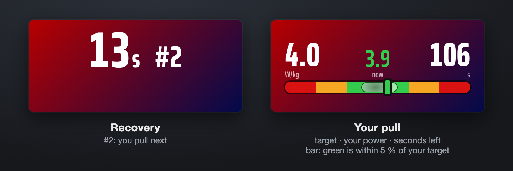

# Paceline 0.3.7-beta.0

Paceline is a mod for Sauce for Zwift that carries your team's TTT plan into the ride. It shows who
is pulling, the countdown to your pull and, during your pull, your target and a power bar. It also
records how the team rides together (who is near you, power, speed, positions) for the team's
analysis. Paceline doesn't calculate plans: they come from the
[ZwiftGopher TTT planner](https://zwiftgopher.com/TTT/), and your captain sends them to the plan
server, where Paceline picks up the plan for your race.

## What the windows show

*Demo data with made-up riders.*

More on these in [Paceline Action](docs/guide.md#paceline-action) and
[Rollers and real climbs](docs/guide.md#rollers-and-real-climbs).

## Install

You need Sauce for Zwift installed and working.

1. In Sauce, open **Settings**, then **Mods**, and press **Open unpacked SauceMods folder**. It
   opens the right folder, also with OneDrive or a translated "Documents" name. Without that
   button, the folder is normally:
   - macOS: `~/Documents/SauceMods`
   - Windows: `%USERPROFILE%\Documents\SauceMods`, with OneDrive maybe
     `OneDrive\Documents\SauceMods`

   If the `SauceMods` folder does not exist yet, create it.
2. Download the newest `paceline-<version>.zip` (for example `paceline-0.3.3.zip`) under **Assets**
   of the [latest release](https://github.com/mafl2k/paceline/releases/latest). Betas such as
   `paceline-0.3.4-beta.5.zip` are not the latest release: they are on the
   [releases page](https://github.com/mafl2k/paceline/releases), marked **Pre-release**. Put the
   `paceline` folder from the zip into `SauceMods`. When updating, replace the old `paceline`
   folder completely; your plans and recordings are kept.
   - macOS: double-click the zip, then move the `paceline` folder into `SauceMods`.
   - Windows: open the zip and drag the `paceline` folder into `SauceMods`. With **Extract All**,
     change the destination to the `SauceMods` folder itself and remove the proposed
     `paceline-<version>` from the end of the path. Otherwise you get
     `SauceMods\paceline-<version>\paceline\manifest.json`, and Sauce silently ignores that.
3. Check that `SauceMods/paceline/manifest.json` exists. Sauce does not find
   `SauceMods/paceline/paceline/manifest.json` or `SauceMods/paceline-<version>/...`.
4. Quit Sauce completely and start it again. Sauce only looks for new mods when it starts.
5. Sauce asks **New Sauce MOD Found**: press **Enable Now**. Sauce restarts by itself after about 4
   seconds; wait for it. If you pressed **Ignore**, enable **Paceline** under **Settings**, then
   **Mods**, and restart Sauce once more. An update shows no "New Sauce MOD Found": go on with
   step 6 after the restart.
6. In Sauce's window list, add **Paceline Info** (a small status box) and **Paceline Action** (the
   big countdown and pull display), and if you like **Paceline Rest** (the countdown alone).
   Outside a TTT event they are invisible: click where one sits to open the settings window, and
   press **Start demo** there to see them. If the Info window looks cramped, drag it bigger (about
   340×190).

From its first store release on, Paceline is also in the Sauce mod store (**Settings**, then
**Mods**), and a store install updates by itself when Sauce starts; betas come only as a zip. To
switch from a folder install, remove the old `paceline` folder from `SauceMods` (or disable that
copy under **Mods**) and restart Sauce, so the windows don't come twice, then add the windows again:
plans, preferences and recordings stay, but each window's appearance settings start fresh.

## Before the race

- Click where a Paceline window sits to open the settings, and check that your club is ticked under
  **Clubs**. The plan then arrives by itself in the race; there is nothing to load by hand.
- Check the plan code with your team: everyone must see the same one.
- The windows are invisible outside a TTT. **Start demo** in the settings shows them for 10
  minutes, so you can place and size them.
- The windows catch mouse clicks, even where you hardly see them. Put them over a part of the Zwift
  screen where you never click. Right-click one to show Sauce's title bar for moving and closing.
- Tick **Captain mode** in the Info window's settings for the Next line. Tick **and keep the whole
  rotation listed during the ride** below it to keep the whole rotation too.

Clubs, private club codes, when Paceline checks and loading a plan from a file are in
[Loading the plan](docs/guide.md#loading-the-plan); everything about the windows is in
[During the ride](docs/guide.md#during-the-ride).

## Your ride data

Paceline doesn't know who is pulling. It works it out every second from what Zwift sends: who is at
the front, power, draft and speed. The rules for that can only be checked and improved against real
races. Without riders' recordings Paceline can't get better, so please send yours.

- Paceline records the ride on your computer.
- Tick **Upload my recordings after each ride** in the settings to send your rides, or export a
  recording and send it yourself.
- On the plan server only the Paceline operator opens recordings, to analyse your team's rides.
  Nothing analyses them automatically yet.
- Heart rate and cadence are never uploaded.
- The server deletes recordings after 90 days.

What is sent, the full reasons and how to export a ride:
[Your ride data](docs/guide.md#your-ride-data).

## For captains

1. Register your club on the plan server, [https://ttt.mafl.net](https://ttt.mafl.net). The club
   link comes by mail: open it within 24 hours and keep it, it is the club's link for good.
2. Add a team and say when it races.
3. **Plan on ZwiftGopher** opens the planner; the plan you send from there arrives on the team
   page. Or export it as JSON and use **Upload a file**.
4. Press **Make live**. Riders listed in the plan get it in the race, from 30 minutes before the
   start.

Private clubs, versions, the rider table and race day are in
[For captains](docs/guide.md#for-captains).

## More

The [guide](docs/guide.md) has everything Paceline does, for riders and for captains. Questions and
bug reports go to [GitHub Issues](https://github.com/mafl2k/paceline/issues).

## For developers

Tests, building and releasing: [docs/development.md](docs/development.md).
