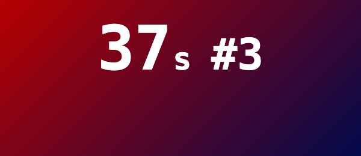
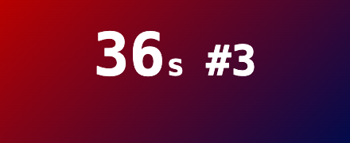
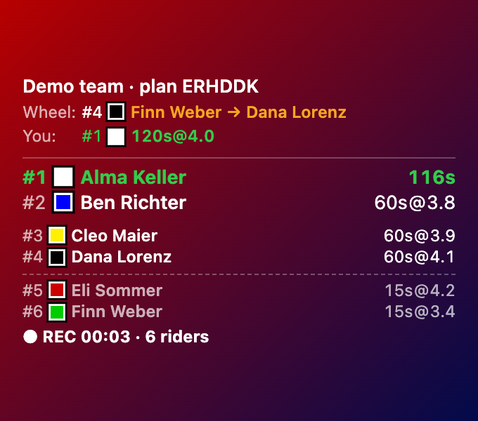
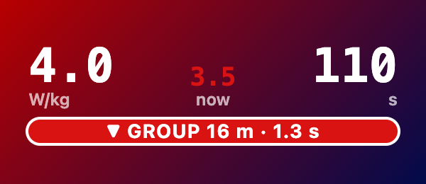

# Paceline 0.2.33

Paceline is a mod for Sauce for Zwift that helps our team time trial. It:

1. Loads the team's TTT plan and shows you the plan code, so we know everyone has the same plan.
2. Shows who is pulling, whose wheel you are on and how long until your pull, and during your
   pull your target watts, the time left and a power bar (new in 0.2).
3. Records how the team rides together (who is near you, power, speed, positions) while you ride.

Paceline doesn't calculate plans. The rotation, pull times and pull watts come from the
[ZwiftGopher TTT planner](https://zwiftgopher.com/TTT/), which does all the maths; Paceline
carries its plan into the ride.

After the ride you send the recording to the captain. Paceline fetches the plan from the plan
server (ttt.mafl.net) and, only when no team name is set, sends your Zwift ID to look it up.
Recordings stay on your computer until you export and send them yourself, or until you switch on
**Upload my recordings after each ride** (see "Recordings upload" below).

  
  

  
  

  
  

  
  
  

*Top: the Action window while resting (time to your pull, your place in the line) and during your
pull (target, time left, power bar). Middle: the Action window when the Rest window has the
countdown, with READY shortly before your pull, and the Rest window. Then the Info
window, for riders and in captain mode with the rotation table (two riders dropped, below the line). Bottom: a gap in the line, first
a gap opening behind you during your pull (early stage), then the group lost your wheel, and you
lost the wheel while resting. Demo data with
made-up riders.*

## Install

You need Sauce for Zwift already installed and working.

1. In Sauce, open **Settings**, then **Mods**, and press **Open unpacked SauceMods folder**.
   This opens the right folder for you, also when you use OneDrive or a translated
   "Documents" name. If you cannot find that button, the folder is normally:
   - macOS: `~/Documents/SauceMods`
   - Windows: `%USERPROFILE%\Documents\SauceMods` (with OneDrive it may be
     `OneDrive\Documents\SauceMods` instead)

   If the `SauceMods` folder does not exist yet, create it.
2. Download the newest `paceline-<version>.zip` (for example `paceline-0.2.33.zip`) from the
   [latest release](https://github.com/mafl2k/paceline/releases/latest), under **Assets**. Put
   the `paceline` folder from it into that folder. When updating from
   0.1.0, replace the old `paceline` folder completely; your plan and recordings are kept.
   - macOS: double-click the zip, then move the `paceline` folder into `SauceMods`.
   - Windows: open the zip and drag the `paceline` folder into `SauceMods`. If you use
     **Extract All** instead, change the destination to the `SauceMods` folder itself and
     remove the proposed `paceline-<version>` from the end of the path. Otherwise you get
     `SauceMods\paceline-<version>\paceline\manifest.json`, and Sauce silently ignores that.
3. Check that this file exists: `SauceMods/paceline/manifest.json`. The `paceline` folder must
   sit directly inside `SauceMods` and contain `manifest.json` itself. Not
   `SauceMods/paceline/paceline/manifest.json`, and not `SauceMods/paceline-<version>/...`: Sauce
   does not find those.
4. Quit Sauce completely and start it again. Sauce only looks for new mods when it starts.
5. On that start Sauce asks **New Sauce MOD Found**. Press **Enable Now**. Sauce then restarts
   by itself after about 4 seconds; wait for it. (If you pressed Ignore, enable **Paceline** in
   Settings, then **Mods**, and restart Sauce once more.) Updating from 0.1.0: replace the
   folder, restart Sauce, skip to step 6. Sauce does not show "New Sauce MOD Found" then.
6. Add the windows: in Sauce's window list, open **Paceline Info** (a small status box) and
   **Paceline Action** (the big countdown and pull display). Optionally also **Paceline Rest**
   (only the countdown, see below). If you had Paceline 0.1.0 open,
   that window is now **Paceline Info**. If the Paceline Info window looks cramped after
   updating, drag it bigger (about 340×190).

## Load the plan

Nothing to load by hand — once the captain has uploaded the plan, Paceline gets it from
ttt.mafl.net automatically.

1. Click a Paceline window. This opens the Paceline settings window.
2. Under **Plan server**, the **Team name is optional: leave it empty.** Paceline then finds
   the plan you are in by your Zwift ID (Zwift must be running). Only if you are in more than one
   plan (for example a starter in one team and on the bench in another), type the team name the
   captain uploaded the plan under and press Enter; without it Paceline takes the newest of them.
3. Within a few seconds the status line says "Server plan: *team* · *plan code* · *time*" and the
   plan shows under **Plan**. Check the plan code as described below.

*The settings window: captain mode, "Only during TTT events", the plan with its code and riders,
the plan server with the optional team name left empty, and the upload checkbox.*

A Paceline window must be open: one of them asks the server. With **Only during TTT events**
(the default) it asks as soon as you enter the TTT start pen, then every minute; while there is
no plan yet, or the last check failed, every 10 seconds, so even a rider who joins the pen 45
seconds before the start has the plan in time. When the captain uploads a changed plan,
Paceline switches to it within a minute, also during the race (the rider pulling keeps his
clock). On the first successful check the server's plan becomes active and replaces a plan you
loaded by hand. If the server cannot be reached, Paceline keeps the plan it has; the settings
window shows the error, the overlay windows do not.

If settings show "plan server is not reachable", load the two files by hand (Plan section) and
switch the plan server off in settings.

### Load the files by hand

If the plan server is down, load the files yourself. A plan loaded by hand stays active until
the captain uploads a changed plan to the server. (To ignore the server completely, untick
**Get the plan from the plan server**.)

The captain gives you two files from the [ZwiftGopher TTT planner](https://zwiftgopher.com/TTT/): the **JSON export** and the
**text export**. You need both. The JSON has the Zwift IDs, the text has the pull watts.

1. Click a Paceline window. This opens the Paceline settings window.
2. Under **Plan**, drop both files into the box, or press **Choose files…**. (There is also
   **Paste instead** if you have the file contents as text.)
3. You should now see the team name, the riders table and a line "You are *your name* · #position ·
   60s@4.4" (your pull time and target in W/kg, or in watts with that setting). Until Zwift is running with your rider, that line says "Waiting for Zwift…"
   instead. That is normal: the plan code check below works without Zwift. Once Zwift runs and
   you are not in the plan ("You are not in this plan") or only on the bench ("You are on the
   bench"), tell the captain.
4. Check the **Plan code**. It is 6 characters long, and everyone on the team must see the same
   code. Compare it with the captain's. If yours is different, you have a different or older plan
   file: load both files again, and ask the captain to resend them if the code still differs.

Press **Done** to close the settings window.

## During the ride (0.2)

**Only during TTT events.** Paceline stays quiet until you join a team time trial in Zwift
(Zwift's event type, WTRL's TTT tags, or "TTT" or "Team Time Trial" in the event's name, for
private TTTs; new in 0.2.31): the Action and Rest windows are empty, the Info window
shows one quiet line "Paceline waits for the TTT start pen", nothing records and the plan server
is not asked. It wakes up when you enter the start pen, and goes quiet again 30 seconds after
the finish. To use Paceline outside a TTT event (a team practice ride, or if Zwift ever changes
how it marks TTT events), untick **Only during TTT events** in the settings window.

**Paceline Action** is the window to glance at while riding:

- While you rest it shows one big clock: the time until your pull starts, in seconds as pulls
  are called (`26s`), above 100 seconds as minutes (`5:47`). It adds up the planned pulls of the
  riders before you plus 10 seconds for each (in the races of 12 Nov 2026 riders went over their
  pull by about that much, whatever its length: the changeover itself). The countdown is only good to
  about 10 seconds (riders pull longer or shorter than planned); the handover itself is called
  out by voice. When the rider at the front reaches the end of his planned pull, the countdown
  runs on for 3 more seconds (the time Paceline needs to see the change) and then waits until
  the next rider is at the front, so it does not run out while someone pulls longer. While it
  waits it says so: the number is dimmed with a `≥` in front (`≥27s`: your pull is at least that
  far away), and under it, small, how long the rider in front is over his plan (`+12`). When the
  change comes it runs on as usual.
  Right of the clock is your place in the line right now, counted in plan order from the rider
  who is pulling (`#1`): `#2` means you are next.
- **READY:** in the last 10 seconds before your pull the window shows three fixed points, each
  with a small label under it: your target on the left (`4.0`, `W/kg`), your power now small in
  the middle (`3.1`, `now`), and `READY` in amber on the right. The power bar is there already,
  its marker white: it shows where you are against the target, so you come up to it before the
  handover instead of surging (being below it in the draft is right, so nothing turns red yet).
- **During your pull** the same three points: your target on the left, your power now in the
  middle, the time left of your pull in seconds on the right (`110`, `s`; amber in the last 10
  seconds, over time it runs on below zero in amber, `−4`). Below is the power
  bar: the middle line is your target, green is within 5 % of it, amber within 10 %, red beyond.
  The marker is your filtered power: single spikes in Zwift's power are thrown out, the rest is
  smoothed over a few seconds, and the marker only moves once that is more than 2 % (about 5 W)
  away from where it stands. So it keeps still while you ride on target, and a real drop of 10 %
  shows after about 4 seconds. Its colour is the zone it is in. In the first seconds of your pull,
  while you ramp up, the marker stays white. The number in the middle is the marker's value (the
  same filtered power, so they always agree), in the marker's colour; kept small on purpose, so the
  bar stays what you ride by and the number only confirms it. Without the text export there are
  no target watts, so you see `–` as the target, your power now, the time and a plain grey bar.
- **A gap in the line** (new in 0.2.28). Paceline watches the distance from each team rider to
  the rider ahead of him. When it is 10 m or more for 5 seconds (15 m on a real climb or
  descent), someone has lost the wheel; the warning ends when the gap has been under 6 m for 3
  seconds. The distance is measured where the line breaks, from the rider ahead of the gap to the
  first one behind it, and shown in metres and in seconds at your speed (`16 m · 1.3 s`). In the
  three recorded races of 12 Nov 2026 this caught every rider who dropped and stayed quiet
  otherwise (4 to 6 warnings a race).
  - **Early stage** (new in 0.2.29): the draft starts to fade from about 6 m (in those races a
    rider got about 31 % of his power from the draft up to 5 m, 22 % at 8 m, 14 % at 10 m, none
    from 15 m). From 8 m for 5 seconds (12 m on a real climb or descent) your power bar gets an
    amber edge during your pull, and the label under your power now says how far back it is
    (`▼ 9 m`): ease off a little before the draft is gone. While you rest, only your own early
    gap shows (`▲ GAP 9 m · 0.7 s`): close up. A threshold of 6 m would have warned 20 to 70
    times a race, as the line normally rides up to 5 m apart; from 8 m it is 4 to 16 times, 2 to
    6 seconds before the full warning at the real drops.
  - **During your pull** a band takes the power bar's place: `▼ GROUP 16 m · 1.3 s` when the
    whole line behind you is gone, `▼ CORA 16 m · 1.3 s` for one rider, `▼ 3 RIDERS …` when the
    line breaks further back. Ease off until it is gone.
  - **Red with a white edge** when the team needs the riders cut off: the team's time is taken on
    its 4th rider over the line (WTRL and ZRL; the plan's minimum finishers if it gives one), so
    with fewer than 4 still together at the front nobody behind the gap may be lost. The group
    behind the puller is always red. **Amber** when the team can spare them (a 6th or 7th rider).
  - **While you rest** the line under the clock says it: `▲ GAP 16 m · 1.2 s` in amber when you
    are the one who lost the wheel (close it), someone else's gap in amber when the team needs
    them (`Cora −16 m · 1.3 s`, `Gap ahead 16 m · 1.3 s`), dim when they can be spared. Your own
    gap and a needed rider go before the standing clock's `+12`.
  - A rider the team can spare who drops 50 m or more is let go: the warning ends and comes back
    only after he has closed up. A needed rider stays in the warning. No warnings at the start
    (the first 60 seconds), in the last 500 m, or while standing still.
- **Wheel cue** (new in 0.2.31): the line under the clock tells you whose wheel to find, with
  their kit colour (`Wheel ■ DANA`):
  - **At the start**, from the roll-off until you have been on that wheel for 2 seconds, your
    first pull begins, or 90 seconds have passed. The first puller gets none.
  - **When your wheel changes** because a rider dropped from the group or came back. The cue is
    shown for 15 seconds once the change has held for 3 seconds, and is amber with the place in the
    line when it is not the plan's wheel (`DANA #3`). It is not shown more than once in 30 seconds
    or in the first 45 seconds of the ride. A change during your pull shows after it.
  - Not after every pull, so it means something when it comes. The planned wheel stays in the
    Info window. The wheel comes from the plan and who is with the group, not from Zwift's order,
    so a team riding in a bunch only sees it at the start.
  - Your own gap and a needed rider go first. A change cue goes before the standing clock's `+12`,
    the start cue after it.
- **Paceline Rest** is an optional third window with only the countdown to your pull and your
  place. During your pull it disappears completely, background included, and from `READY` on (the
  last 10 seconds before your pull) too while an Action window is open, which takes over then;
  without one it shows `READY` itself. The Paceline windows notice each other: each one leaves a
  sign of life every 2 seconds, and one not heard for 6 seconds counts as closed. If the big countdown in the middle of the screen is too much while you rest, open
  the Action window's settings, untick **Show the countdown to my pull here too**, and put the
  Rest window wherever it suits you, for example lower down. The Action window then stays empty
  while you rest (not even the dash). In the last 10 seconds before your pull it wakes up with
  READY (target, power now, the bar), and when your pull starts the time takes over. Ticked (the default), the Action window
  works as before and the Rest window is not needed. Unticked but no Rest window open, the Action
  window shows the countdown anyway, so it is never missing. Tip: with Sauce's Transparent theme for the
  Action window, the empty window disappears completely.
- Targets are shown in W/kg (since 0.2.17; before it was watts), everywhere one number. To see
  watts instead, open the settings window and set **Pull target** (under **Plan**) to **W**.
  Paceline divides by your weight in Zwift (or the planner's weight if Zwift gives none), with one
  decimal like Sauce; without any weight it shows watts. The power bar compares in percent of the
  target either way. If you had picked W before 0.2.17, pick it once more.
- An empty window means Paceline has nothing to show: outside a TTT event, no plan is loaded,
  Paceline does not know your rider yet (Zwift has not run in this Sauce session), you are not a
  rider in the plan (bench or not listed), or the last 500 m of the race (the rotation is off for
  the sprint).
- An amber `?` means Paceline cannot tell: no teammate is near you (dropped, or their data has
  stopped), there is no current Zwift data for your own rider (Zwift stopped, you only
  spectate, or no data for 15 seconds), or nobody is being tracked at the front. Before the
  start the window stays empty instead: while you stand still (the start pen) Paceline tracks
  nothing. After a stop during the ride the windows stay empty for 40 seconds after rolling on,
  because the order at the front is chaos then.
- **The start is set, not detected.** Plan #1 does the start pull (in the TTTs of 12 Nov 2026 he
  always did, often after someone else led for the first seconds). In the start pen his windows
  are armed already: `READY` with his target, his power now and the bar. When the group rolls
  off he pulls at once, and his first pull is his plan time plus 30 seconds (a 2:00 pull shows
  2:30), counted from the roll-off. Everyone else's windows stay empty until #1 has been in front
  for 3 seconds (the start chaos is over), at most 60 seconds. For those 60 seconds Paceline
  detects nothing at the front, no climb either. After that it follows the front again; a rider
  other than #1 then has to stay in front for 15 seconds to count.
- **Rollers and real climbs.** A hill is a climb from 4 % and a descent from -3 % (until the road
  is back below 2 % or above -2 %). In a TTT event Paceline knows the hills before you get there:
  it loads the route's elevation profile from Sauce and finds your place on it from your altitude
  (after the first kilometre; one-lap events). A **roller** (at most 400 m long and 15 m up or
  down, like all hills of the 12 Nov 2026 TTT) does not stop anything: the countdown goes on, and
  only the rider pulling or the plan's next rider can take the front, so a teammate sprinting up
  from behind (often on descents, while the front rider drops back) is ignored. A **real climb or
  descent** pauses the rotation: a triangle (`▲`, or `▼` for a descent). Without the profile
  (before your place on it is known, or on a route Sauce has no profile for) Paceline goes by the
  grade under your wheels: a hill counts once the grade has held for 5 seconds, as a roller for
  its first 45 seconds and as a real climb or descent after that. If the same rider is still
  in front after a real climb, his pull time simply goes on. If another teammate is in front first and
  the rider from before comes back to the front within a minute, his pull time goes on from
  where the climb stopped it instead of starting at 0; the climb and the other rider's turn do
  not count (the same after riding alone).
- The Info window shows `Front: –` in these cases, or "Climb – rotation paused", "Descent –
  rotation paused" or "Finish – rotation off".

**Paceline Info** is the status box. Every line keeps its place, so the box never jumps. The text
grows and shrinks with the window: make the window bigger for bigger text (every line stays on
one row, so a wider window helps most). On top what stays the same during the ride, in the order
you ride (the wheel you follow, then you); below, set apart, the live part. All rider lines
share one set of columns: label, plan number, kit swatch, name, and the pull right-aligned and
lined up on the `@` (`60s@4.4`: pull time, then the target without its unit, which the setting
below decides):

- The plan line: team and plan code.
- **Wheel:** the wheel you follow, by the plan: the rider before you in plan order (the
  last rider if you are #1). Learn it before the start; it stays put while you pull too, since
  that is the rider you drop in behind. If that rider is not with the group, it shows in amber
  who to follow for now, e.g. `Dana → Cora`. Zwift's positions behind the first few riders are
  often jumbled, so Paceline takes this from the plan, not from where riders appear.
- **You:** your number in the plan, a swatch of your kit colour (so you know
  which socks/kit to pick), and where the Wheel line has its name your planned pull time and
  target (`#4 ■ 60s@4.4`).
- **Front:** who is pulling, their number and kit colour, and at the right the time left of their
  pull in seconds, as pulls are called (`12s`); over their time it runs on below zero in amber
  (`−4s`). During your own pull it says **You**. A dim `–` means no rotation right now (before the start, alone, no data).
- **Next** (captain mode): tick **Captain mode** in the Info window's settings (at the top, under "This window"), and a line
  under Front shows who pulls next with their full pull line (`#4 ■ Dana  60s@4.4`),
  ready to call out. Dimmed, it is the plan's guess: before the start it shows plan #1 (who
  starts), on a real climb or descent, riding alone or without data the plan's next after the last puller. It
  turns live again as soon as a puller is at the front; in the final sprint it shows `–`. Make the Info window a little taller for it.
- **The whole rotation** (before the start for everyone): one row per rider, `#3 ■ Name
  60s@4.4`, from the rider pulling (before the start from plan #1), you highlighted. Once the
  rotation runs it goes away. In **Captain mode** you can keep it: tick **and keep the whole
  rotation listed during the ride** below it. Then it stays and turns with every change. Riders
  dropped from the group (more than 20 m back for 20 s) move to the bottom (new in 0.2.30), dimmed, in plan order
  below a dashed line, and come back into the rotation once they are with the group again. Its first two rows take the place of the Front and Next lines: the
  rider pulling (bold, with the time left, or `▲`/`▼` while a real climb or descent pauses the
  rotation) and the next rider, in a larger text and set apart from the rest by a small gap. Make the Info window
  taller for it.
- The recorder line.

How Paceline decides who pulls: the puller is simply the frontmost rider of your team group
(teammates within 20 m of each other), once they have been in front for 3 seconds. Within 30
seconds of a change at the front (a new puller, your own pull starting or ending, the end of a
real climb or descent) a new front rider must stay there for 15 seconds instead, so a short shuffle in
the chaos does not count as a pull; his pull time still counts from when he got there. The same
15 seconds apply to a teammate who would skip the planned next rider (one or two places further
on in the plan), for example when he shows up at the front for a moment during a change. Nothing is
tracked while you stand still (below 2 km/h, e.g. in the start pen). The pull
time counts from when they got there. Your own pull is also picked up from your riding, once
you are the next rider and the rider in front is due (10 seconds or less of his pull left) or
gone (nobody of the team ahead of you): it starts when you jump up in power and your draft
drops to zero, or as soon as your draft is zero with a teammate behind you. It ends when your
power drops sharply below 130 W after at least 20 seconds of pulling, so swing off clearly when
you are done. The time to your pull adds up the planned pulls of the riders before you, plus 10
seconds for each changeover, skipping riders who are not with the group. Paceline does not know the plan was followed: after
a crash, a dropped rider or a messy changeover the display can be wrong for a while. Ride the
plan and talk on voice; use the display as a help, not as the referee.

Tip: open both Paceline windows before the start. A window opened mid-race shows its own pull
timing until the next handover.

**Demo:** to place and size the windows without Zwift, open the settings window (the tune icon
or a click on a Paceline window) and press **Start demo**. For 10 minutes all windows show a
made-up ride with your plan (or a sample plan if none is loaded), marked `DEMO`. Zwift data is
ignored and nothing is recorded or uploaded meanwhile. **Stop demo** ends it early.

**Background:** the windows look like Sauce's own: theme colours, background texture, and the
theme's transparency (with a **Transparent** theme such as Dark the background disappears and
shows again when you move the mouse over the window). For your own colour or opacity, open the
settings from that window and tick **Solid background** under Appearance and set the opacity with the slider (100 = opaque). Each
Paceline window keeps its own, as in Sauce's windows; the Action window has its own settings
window for that.

### Recorder

- Start Zwift and Sauce as usual and keep a Paceline window open (either one records). The Info
  box shows the plan name and code, and either "Recorder ready (needs 2 team riders)" or "● REC"
  with a timer.
- Recording starts by itself when you enter the TTT start pen and stops by itself 30 seconds after
  the finish, once Paceline has a plan with you in it (it may arrive a few seconds into the pen),
  with or without teammates near you, so there is a recording also when something went wrong.
  Without such a plan it does not record (new in 0.2.31: that recording would never go up), unless
  you tick **Also record without a plan** in the settings window. It holds you and the plan's
  riders (and bench); when fewer than two of them are near you (no plan, the wrong plan), it also
  holds the riders of your event within 300 m of you, the 15 nearest, which in a TTT is in
  practice your team. In between it keeps recording even when you ride alone (dropped). After
  the stop the ride goes up, if you upload (that needs a plan or a team name; otherwise export it
  from the settings window). You do not have to press anything. (With **Only during TTT events**
  unticked it works as before 0.2.18: it starts when you and a teammate from the plan are near
  each other and stops 120 seconds after fewer than 2 are left.) Each recorded second also notes who Paceline thought
  was pulling and what the windows showed (countdown or pull, your place, Wheel, the captain's
  Next, a gap warning), so the ride can be compared with the plan afterwards. It also notes the Zwift event you
  are in (name, type, subgroup and start time) and Zwift's ride clock, so a later version can tell
  the start pen from the race.
- If the box says "Waiting for Zwift…", Sauce does not see your own rider (for example when you
  only spectate). Nothing is recorded then.
- Hiding Sauce's overlays with its hotkey is fine, recording continues. Closing the Paceline
  windows or Sauce stops recording.
- With more than one Paceline window open, only one of them records. The others just show
  the status.
- Some Zwift events hide the overlays and rider data from Sauce on purpose (events marked
  "nooverlays" or "hidethehud"). Sauce gets no nearby riders there, so nothing can be recorded.

**The Paceline windows catch mouse clicks**, even where you hardly see them. Put them over a part
of the Zwift screen where you never click. To move or close one, right-click it: that shows Sauce's
title bar. Right-click again to hide it.

## Why we ask for your ride data

Paceline does not know who is pulling. It works it out every second from what Zwift tells
Sauce: who is at the front of the group, power, draft and speed. The rules for that (how long a
rider must be in front to count as the puller, how big a power jump starts your pull, how sharp
a drop ends it, how far apart riders may be and still count as one group, from which gradient a
climb pauses the rotation) were set from a few FIT files of past races. Those files have no
positions in the line and no draft, so nobody has checked the rules against the data Paceline
actually sees during a race. Your recordings do that.

With them we can check, second by second, what Paceline showed against what really happened:

- Did it see the change at the front on time, or late, or not at all?
- Did your own pull start and end when you actually went to the front and swung off?
- Did the place in the line (`#3`) and "Wheel" match the real order?
- How old is your teammates' data when it reaches Sauce, and how much does that jumble the order?
- Is draft a better signal than position? This decides how the next version detects pulls.

The captain can also compare the plan with the race: how long each pull really lasted, at
what power, and where the rotation broke up (climbs, a dropped rider, the sprint). That helps to
set pull times everyone can actually hold. It is not a ranking, and nobody is judged on it.

What happens to the data: the captain and the developer of Paceline use it for exactly these
two things. It is not passed on and not published. Heart rate is never uploaded. The captain
deletes recordings once they are evaluated. You can always ride without sending anything:
recording only stays on your computer unless you export it or tick the upload box.

## After the ride

1. Click a Paceline window to open the settings.
2. Under **Recordings**, find your ride (it shows the date, how long it lasted and the plan code).
3. Press **Export**. A normal Save dialog opens and asks where to save the file (it ends in
   `.jsonl`). Pick a place you can find again, such as the Desktop.
4. Send that file to the captain.

You can export a ride more than once. **Delete** removes a recording from your computer for good.
Paceline keeps the newest 20 recordings and removes any older than 14 days, so export soon after
the ride.

### Recordings upload

Instead of exporting by hand you can let Paceline send each ride to the captain. It is off
until you switch it on: in the settings window, under **Plan server**, tick **Upload my
recordings after each ride**.

- **What is sent:** only what the analysis needs: power, draft, speed and position of you and
  of the riders in the plan, with your Zwift ID and the plan. Left out: everyone's heart rate
  (yours too) and cadence, weight and FTP in the plan, and any rider you watch who is not in the
  plan. The file you export yourself still has everything.
- **Where it goes:** to the plan server set under **Plan server** (normally ttt.mafl.net), filed
  under your team name (the one you typed, else the server plan's team). There the captain can
  download it. The server only takes recordings for a team that has a plan on it.
- **When:** right after a recording stops (which is 2 minutes after the team has split up), or
  later while a Paceline window is open and Zwift runs; never while it is still recording, and
  only while the plan server is switched on. Only rides recorded after you ticked the box go up
  on their own; older ones, and recordings shorter than a minute or older than 7 days, are not
  sent automatically, but **Upload** sends them. If the server cannot be reached, Paceline tries
  again every 5 minutes; if the team has no plan on it, after an hour; a recording too large for
  the server is not tried again on its own.
- Under **Recordings** each ride then shows "uploaded", "waiting for upload" or "not sent
  automatically" (with the reason if the last try failed), and **Upload** sends a ride right away.

## For developers

- `npm test` runs the tests.
- `bash scripts/zip.sh` builds `dist/paceline-<version>.zip`.
- Open `pages/paceline.html?demo` and `pages/action.html?demo` through a local web server to try
  them without Sauce (load the plan first in `pages/settings.html?demo`). The demo team rotates
  every 20 s for 60 s, then only you are left for 130 s. Gaps open in your first pull (the
  group), in the pull after it (you), in your second pull (the early stage only) and in your last
  pull (one rider).
