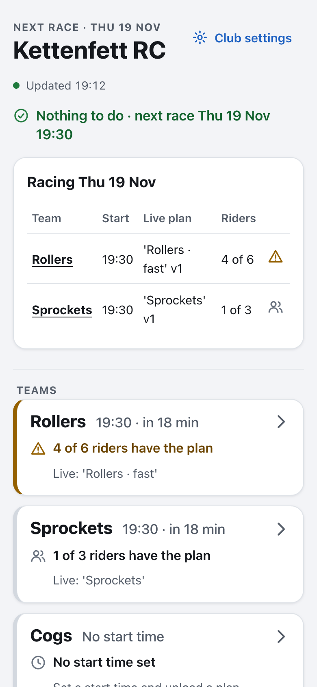
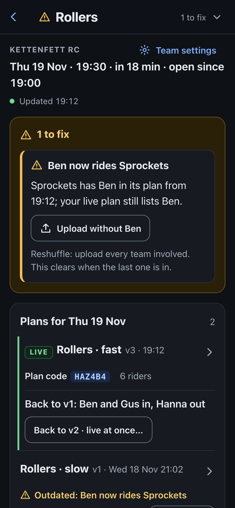
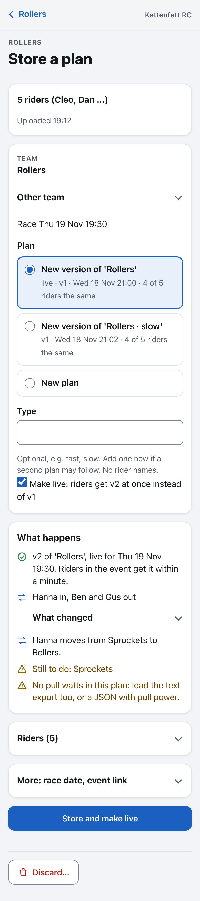
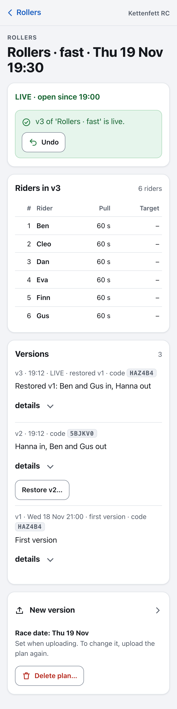

# Paceline plan server (0.3, circles)

A small web server for the Paceline mod. A **club** (circle) keeps its teams' TTT plans: a team
captain's planner export is stored as a **plan** in one of the club's teams, and each rider's
Paceline mod asks the server which plan it should ride. The server also takes the mod's session
recordings, per club.

Node 22, `node:http` only, no npm dependencies. It validates and strips plans with the mod's own
`pages/src/engine/plan.mjs`, so plan codes are the same as in the mod.

Captains work in a browser: they register a club at `/register`, open their teams with a link that
arrives by mail, and upload the planner's export there. A team may have a few plans for one race
("Rollers", "Rollers · slow"); every upload of a plan is a new **version** (v1, v2, …) with what
changed against the one before, and a captain can go back to an older version. The operator has a
page of their own (`/admin`). Every page is server-rendered HTML with forms; the captain pages need
one first-party script, and only Make live works without it (see Pages). `/privacy` is the binding
text on what the server keeps; this README only describes it.

## What it does

- Answers the **plan check** `GET /api/v3/rider/<zwiftId>`: which clubs list this rider, which plan
  he rides, and, from 30 minutes before the start, the plan itself.
- Keeps **private clubs** hidden from everyone who does not hold the club's rider code.
- Takes plans **pushed from ZwiftGopher** (`POST /api/v3/push`, proof of concept): the team's upload
  page links to the planner with a short-lived token, the planner posts the plan back, and it waits
  in the team's inbox until the captain stores it (see "ZwiftGopher push").
- Tells old 0.2.x mods to update (**notice**): there is no compat mode (hard cut, 17 Nov 2026).
- Accepts **recordings** per club, refuses heart rate and cadence, drops riders outside the team's
  plans, and enforces quotas and a retention time.
- Keeps its state in one SQLite file and writes a **database dump** every night.

## Data flow

The mod sends the rider's Zwift ID, the club ids the rider joined, the mod version and, from inside
a Zwift event, the event's start and id. The server answers from memory. For the Zwift IDs a club lists in its plans the server keeps a
small record of the last check (time, plan code, mod version, in event or not, event id) for 14
days, so the club can see who has the right plan. A plan's content (rider names, Zwift IDs, weight,
order, pull times and pull watts, colours) goes only to a rider who is listed in it, only from inside
his race and only from 30 minutes before the start; for a private club only with its code.
Height, FTP and the planner's other fields are never stored in a plan, and never go to a rider. The
one exception is a plan's ZwiftGopher link (below): it encodes the whole plan as the planner has it,
FTP and height included, and is kept beside the plan for the captains' own pages only. The privacy
page (`/privacy`) is the binding text.

The mod says the same in its settings: "When you are in a Zwift event, and when you open these
settings, Paceline sends the plan server your Zwift ID, the clubs you ticked, the codes of private
clubs you added, your event's start time and id, your plan code and the Paceline version. A club you
ticked sees when you last checked."

**The lookup by Zwift ID.** Line-ups are public on ZwiftPower, and the check takes a Zwift ID in the
path, so anyone who knows an ID can ask which open clubs list it and sees the label, team and start
time of the plans that list it. A plan's content (names, Zwift IDs, weight, order, pulls) goes only
to a check in its race from 30 minutes before the start. A private club shows nothing without its
code. Weight is in the plans for W/kg.

## Pages

All pages are server-rendered HTML with plain forms and one functional cookie (plus the short-lived
flash cookie, below). The captain pages need one first-party script, `/static/app.js`: it redraws
the assign page when a choice changes, opens the confirm strips in place and does the guarded
reload. Make live (also "Make vN live" and Restore of the live plan) and every action that asks
first work without it, as a plain POST answered by the server's confirm page; the other captain
pages say that they need the script. The public pages and `/admin` have no script. The public pages (start page,
register, lost link, the `/m/` and `/t/` pages, privacy) look like the captain pages: cards, buttons
and fields from the same stylesheet, light and dark; `/admin` keeps its plain look. Every state change is a POST from the same site; no GET changes anything,
so link previews and mail scanners do no harm. Pages carry `noindex`, `Referrer-Policy:
no-referrer` and a neutral title.

| Path | What |
| --- | --- |
| `/` | without a club open: register, lost link, privacy. A browser whose cookie still opens a club goes straight to `/manage` (303; Several clubs, below) |
| `/register` | club name, e-mail address, time zone and the required box "I will tell my riders that their Zwift IDs and names are in the plans". Answers "Check your inbox" whatever happens. A club that is not confirmed within 24 hours is deleted |
| `/m/<token>` | the club link from the mail (open it within 24 hours; from then on it is the club's link for good, until a new link from Lost link is opened: the mails, this page and the first-run page tell the captain to bookmark it): a page with one button; the button starts a pending club or opens the club, puts the club first in the cookie `__Host-pl_club` (up to 5 clubs per browser; every time the server sets the cookie, all of them are kept for another 400 days) and goes to `/manage`. Opening a new link ends the older links |
| `/switch` | POST only, from the captain pages' footer: `club=<id>` of a club the cookie opens becomes the active one, then `/manage`; any other id changes nothing and goes back to `/` |
| `/logout-all` | POST only, from the captain pages' footer: clears the club cookie |
| `/lost` | the address gets a new link for each club it registered; the answer is always the same neutral text. The old link keeps working until the new one is opened |
| `/t/<token>` | confirmations: an address change or a deletion (both first by the current address; a new address confirms too) |
| `/manage` | the club hub: what to fix, plans waiting, the races (Captain pages, below) |
| `/manage/team/<slug>` | one team: status, live plan with its version and what changed, Restore and Undo, riders, other plans of this race; "Upload a plan" and, with `PUBLIC_URL`, "Plan on ZwiftGopher" (buttons under the race line, or the empty card's two big buttons) |
| `/manage/team/<slug>/plan/<id>` | the plan page: head, Make live, rider order, versions with what changed and Restore vN, New version, "Edit on ZwiftGopher" (when the plan has a ZwiftGopher link), race date, Remove event link, Delete |
| `/manage/team/<slug>/settings` | rename, start time, race rhythm, event links, delete the team; never reloads |
| `/manage/new-team` | add a team |
| `/manage/upload?team=<slug>[&plan=<id>[&from=plan]]` | the upload page: the JSON file (or pasted, folded) and the optional text export; Continue goes on to the assign page; never reloads. From a plan page's New version (`from=plan`) the assign page, Discard and the result go back to that plan |
| `/manage/inbox/<id>` | the assign page: team, plan, type, Make live, date, event link and the preview; Store or Discard |
| `/manage/settings` | club settings: name and zone, race day of weekly teams, address, private club, remove a rider, recordings, activity, delete the club |
| `/static/app.css`, `/static/app.js` | the captain pages' stylesheet and script; each has an ETag of its content, and a link with the matching `?v=` is cached for a year |
| `/admin` | the operator page (below) |
| `/admin/recordings?cid=<cid>`, `/admin/recordings/file`, `/admin/recordings/race` | an active club's recordings for the operator to download (below, Recordings for analysis) |
| `/privacy` | what is kept, who sees it, for how long and where it is processed; with a club cookie a back bar to `/manage` |

**Several clubs in one browser.** One address may own several clubs, and one captain may plan for
several, so the club cookie keeps up to 5 club links, joined by `.` (a character no token has), the
active club first; a cookie of one token is the same format. The captain pages act on the active
club only: the first token that still opens an active club. Opening a club link puts that club
first and drops its older tokens; a sixth club pushes out the one used longest ago. `/` goes to
the active club's `/manage`; the start page is only for a browser without a club open. The captain
pages' footer (at the bottom of the sidebar from 1024 px, at the end of the hub and the club
settings on a phone) lists each other club the cookie still opens, by name, as a button that posts
its club id (never a token) to `/switch`, which moves that club first. Every
captain page names its club (the hub's heading, the right side of the top bar, the kicker, or
from 1024 px the breadcrumb), and every form that posts to `/manage` carries the club it was drawn for (a hidden
`club=<id>`). The server acts only when that is still the club the cookie has open: a page left open
from another club (the captain switched in another tab, or the page's club link ended and the
cookie fell through to the next club) gets 409 with the open club's teams and "This page was for
another club", and nothing changes; a form without the field, as out of date. With more than one
club the footer has, after the other clubs and Privacy, "Log out of <club>" and "Log out of all
clubs". Log out drops only the club of its page, also from a tab left open on a club that is no
longer the active one; `/` then leads to the next club the cookie opens, or to the start page when
none is left. "Log out of all clubs" clears the cookie, and a club deleted by its confirm link drops out of
the cookie that confirms it. Tokens that no longer work drop out whenever the server sets the
cookie, and a cookie with none that works is cleared. A Cookie header that names the club cookie
twice counts as none.

**Captain pages.** After the club link a captain lands on the club hub (`/manage`), then works on
one team per page. On a phone every page has the team switcher or a way back. From 1024 px wide every
captain page has the same frame: a sidebar with the club name (the way to the hub), the
teams and, at its bottom, the browser's other clubs, Privacy and Log out, the current place marked
(the club on the hub, the team on its page and every page below it). Club settings is no
entry of the sidebar or the phone's team switcher: the button beside the hub's title leads
there (and the hint in the team settings). Beside the sidebar is the
page, left-aligned, its head the same everywhere (the title and the page's action, such as Team
settings, right beside it). **Breadcrumb:** from 1024 px every page below the hub starts with one
breadcrumb line where a phone has its back bar and the kicker: "Kettenfett RC › Rollers", "Kettenfett
RC › Rollers › Rollers · fast", "Kettenfett RC › Rollers › Upload", "Kettenfett RC › Club settings";
every crumb but the last is a link (`<nav aria-label="Breadcrumb">`, the last crumb
`aria-current="page"`). The phone's back bar and the breadcrumb are drawn from the same crumbs, so
the bar always goes where the crumb before the page goes, under one label for the way to the hub:
"All teams" (the club's name is its crumb). A question without the script ends in "Confirm" after
the page its way back leads to; its Cancel sits beside the confirm button from 1024 px, under it on
a phone. The sidebar marks the hub or the team page as the current page, and on a page below it the
place as the current location (`aria-current="location"`). Forms are one column, the team page two.

<p>





</p>

- **Club hub** (`/manage`): the club, its next race ("Next race · Thu 19 Nov") with Club settings
  beside the name, "Updated 19:12", then each block only when it has something. **To do before the
  race**: every fix item across teams on one line each, the team, its start time, the problem in
  the team page's words (riders in another event, "Ben now rides Sprockets", no start time, no live
  plan near the race) and the team page's own button for it (Remove event link, Upload without Ben,
  Set the start time, Upload a plan, "Make one of its plans live" to the team page's plans), by
  start time, then the worst first. **New plans from ZwiftGopher**: every plan waiting, with its
  team, "Sent 19:12", the planner's team name, the riders, Review and store and Discard (back to the
  hub). The hub's buttons name their team for screen readers and voice control ("Review and store
  (Rollers)"), and its Remove event link comes back to the hub. From 1180 px each of these is one
  line, its words at least 12rem wide; narrower, the buttons go under the words. Then one table per
  race day, the next first, up to 7 days ahead (a next race further away: that one alone): each team racing that day
  (a link), its start, the live plan and version, "4 of 6 have it" once the plan is open or "opens
  19:00" before, and the worst state as an icon. With nothing to do and nothing waiting one line
  says so: "Nothing to do · next race Thu 19 Nov 19:30" (or "no race planned"). From 1024 px that
  is all (the sidebar lists the teams); on a phone the team tiles follow under "Teams", one per team
  in start time order (never by status; a special team by the start of its next race, and one
  without a race after the weekly teams). A special team with nothing in the next 14 days folds into
  "Other teams (n)" below the rest; weekly teams never fold. "Add a team" at the end. A club without
  teams gets three steps and the add-team form instead; that page never reloads.
- **Team kinds.** A team is **weekly** (it races every week on the club's race day, Thursday unless
  the club settings say otherwise, or on a day of its own, always at the team's start time) or
  **special** (a ZRL team, a yearly event: no fixed times at all, so the date and the start time
  come with each upload). "Add a team" asks for the name and the race rhythm: "Every week on" a day
  (the club's by default) with the start time, or "Special: date and start time come with each
  plan"; a special team gets no start time of its own (a posted one is ignored). The team settings
  change it under "Race rhythm"; a special team's settings have no start time card, only the line
  "A special team gets its date and start time with each plan." A special team's start time
  belongs to the race (team and date): every plan of that date starts at it, and the newest upload
  for the date sets it (see the assign page). Switching keeps the stored start time, and the flash
  says what it means for the plans: a team made weekly again races at the team's start time ("Its
  plans now start at 19:30, the team's start time."); a team made special keeps its plans' times.
  A special team's race stored before 0.3.1 has no start time of its own and races at the team's,
  as it did. "No start time" (red) is for weekly teams without one, and for a special team's race
  that has plans but no time at all (stored before 0.3.1, the team without one), live or not; its
  callout leads to the upload of that race's plan, whose Store sets the time. A special team with
  no plan stored has "No race planned" (neutral, no time line); with a plan stored but none live,
  "No live plan", as a weekly team. A line never shows a missing time: without one, the day alone. A new plan's default race date is the live plan's date while that race is still
  to come or running (until 2 h after its start); otherwise the kind sets it: a weekly team's next
  race day, a special team's newest plan still to race (or none, and the date is then asked for).
- **Team page** (`/manage/team/<slug>`), the race-day view: one race line with the opening time
  ("Thu 19 Nov · 19:30 · in 2 h 40 min · opens 19:00"), what needs fixing, then "Plans for Thu 19
  Nov": one row per plan of this race in a fixed order (only the LIVE mark moves), each linking to
  its plan page. The live row shows its version and time ("v2 · 16:05"), the plan code, the riders
  count, what changed against the previous version with its version ("v2: Cleo in, Ben out"; a
  restored one "v3 (restored v1): …"), "Restore v1" and, when a newer version is not live, "v3 ·
  16:40 is newer, not live" with "Make v3 live". The other rows show what is outdated
  ("Ben now rides Sprockets"), a short rider list and Make live. Under the plans: the live plan's
  riders (never the planner's roster, the club's rider pool). Under the race line the two ways to a
  plan are buttons: "Upload a plan" and "Plan on ZwiftGopher" (a new tab; only when the server
  has `PUBLIC_URL`), side by side at full width on a phone, where the second reads "ZwiftGopher"; a
  team without plans has them as its empty card's two big buttons instead. Team settings is a quiet link at the
  top right on a phone and beside the title from 1024 px, as Club settings is on the hub; a weekly team without a start time also gets "Set the
  start time" in its red callout (a special team's race without one: "Upload it with its start time"). Make live ("Make v3 live" and Restore of the live plan too)
  asks first only when it matters: while the gate of the race it affects is open (from 30 minutes
  before the start until the race is used up, for the plan replaced or the one becoming live) or
  when its words warn (outdated marks, a rider it moves, a team it leaves with a hole, a plan of
  another race, no start time). Then the button turns, in its place, into a strip with what riders
  get and when ("Riders in the event get … within a minute"; before the gate "From 19:00, riders get
  …"; Restore names the riders that change, "With v1: Hanna in, Ben out."), "Make live" and Cancel.
  Otherwise it acts at once: the page comes back on the row of the plan live now (`#plan-<id>`), and
  that row, where the action was, says so and offers Undo ("v3 of 'Rollers · fast' is live · Undo"),
  for 10 minutes and only while nothing else changed; Undo makes the version that was live before
  live again, under the same rule (an Undo that has to ask is confirmed as an Undo). Store and make
  live on the assign page asks nothing (its "What happens" is the question) but offers the same
  Undo. The server decides it again on the POST, so a page drawn before
  the gate opened still asks. A team has one live plan, so Make live of a plan for another race
  says that it ends the live plan for its race ("riders get nothing for that race") and asks "Make it
  live anyway?". Make live, "Make vN live", Restore, Undo and Delete plan carry the team's version: a
  page drawn before someone else changed the team is refused ("Rollers changed since you opened the
  page. Nothing was changed.") and drawn anew. Raced plans are not listed.
- **Asking first, in place.** No destructive action happens on one press. The confirm strip
  replaces the button where it was (full width on a phone): what happens, the confirm button and
  Cancel; Esc and Cancel close it, one is open at a time, it has no timeout, a press of the confirm
  button within 450 ms of opening it is ignored (a double-click never confirms), and an open strip
  holds the guarded reload. Without the script the button posts and the server answers with a page
  that asks. Delete plan, Delete team, Discard (set apart from Review and store and from Store), New
  ZwiftGopher link, New rider code, Make private, Remove a rider (naming the Zwift ID, also as edited
  after the strip opened), deleting a recording, and clearing a start time or changing the zone while
  a race starts within 7 days all ask; a form posts once until the page answers (a double click
  never sends it twice); their confirm button has
  the one danger style (red), the button that asks for it red text on a plain button.
- **One button system.** Primary (filled blue): a block's main action, at most one, first (Store,
  Review and store, each settings card's Save, the strip's Make live, Add the team). Secondary
  (outline): further actions (Upload a plan, Plan on ZwiftGopher, Restore v2…, Make live…, and the
  Cancel beside a confirm). Quiet (a text link): navigation and side things (Team settings, Club
  settings, What do these mean?, the way back from a result). Outline with red text: the button that
  asks first (Delete…, Discard…, Remove…); red filled only as its confirm. One word per action: Save
  name, Save start time, Save race rhythm, Save club; Discard…; Remove event link; Restore vN.
- **Plan page** (`/manage/team/<slug>/plan/<id>`): the plan's head (its label, such as "Rollers ·
  slow", the race, LIVE or Make live, and "Make v3 live" for a newer version that is not live), its
  rider order, its versions newest first (time, plan code, what changed, with every line in a fold,
  and "Restore vN" on every version but the newest, the live one and those with the plan code
  riders have, which would only store the same plan again), then New version (the upload
  page for this plan), the race date, Remove event link and Delete plan. "Restore vN" makes a new
  version with vN's content; for the live plan it goes live at once, asking first as Make live does. A raced plan's
  page shows the lists without buttons.
- **Plans have no name.** A plan is its team plus an optional **type** ("Rollers · fast"; "Rollers"
  without one), within one race. Types are unique within a race, and at most one plan of a race has
  none. The type field suggests the team's earlier types. The planner's team name in the JSON helps
  to preselect the plan on the next upload; it is shown only as the hint of a received plan (below),
  cleaned of control and bidi characters and cut at 60 characters.
- **Received plans.** A plan pushed from ZwiftGopher (below) waits in the inbox for its team. The
  team page lists every one, newest first ("2 new plans from ZwiftGopher": the time it came, the
  planner's team name as a hint, the rider count, "Review and store" to its assign page, Discard);
  the hub lists them under "New plans from ZwiftGopher"; the team's row in the sidebar, the switcher and the hub's tile say "1 new plan" / "2 new plans"
  (neutral blue, not a problem). The assign page says "From ZwiftGopher, 19:42" and starts with Make
  live off. A received plan goes after 7 days, an upload left on the assign page (shown nowhere)
  after 24 hours; deleting a team deletes the plans waiting for it. A new plan comes in by itself:
  a team page with received plans waiting reloads every 60 seconds (every 30 around a race, as
  always). The upload page never reloads (a chosen file would go); it says "2 plans from ZwiftGopher
  are waiting" with the way to the team page.
- **Team status** has one line per team, and its colour shows the worst state: red when riders get
  nothing (no plan, no start time, riders in another event than the event link), amber for "check"
  (a hole, riders on an older plan code), grey before the gate ("Opens 19:00 ..."), green when all
  riders have the plan. Before the gate (30 minutes before the start) no rider state is shown,
  because none is recorded. A team without a live plan is red only from 2 days before its next
  race; before that it is neutral ("Next race Thu 26 Nov", or "No live plan yet" when plans are
  stored), so a weekly team is not red in the days after its race.
- **Club settings** (`/manage/settings`): name and zone, the race day of weekly teams, the masked
  address with Change e-mail,
  Mail a new link, the private-club switch (a rider code, shown once) and Remove a rider by Zwift
  ID; then a band with the recordings (team, date, rider, a Delete button each that asks first) and their quota,
  the upload log, Delete club and Log out. Captains cannot download a recording.
- **After a POST** the server answers 303 to the page the form came from, which shows what was done
  once (the flash). It is kept in memory for 5 minutes, bound to the club and the path, and only
  its id travels in the `__Host-pl_flash` cookie, so a restart loses at most a message. The
  rider-code page, the result page of Store, the confirm pages (the no-script path of every action
  that asks first) and refusals are direct answers.
- **Reload.** The hub and the team pages reload themselves every 30 seconds from 90 minutes
  before to 60 minutes after a live plan's start; outside that window a team page with plans from
  ZwiftGopher waiting reloads every 60 seconds. Pages with forms to type into never do (the upload
  page among them). With the script the reload is guarded: not while the tab is hidden, a field has
  focus, a menu is open or a form was changed, and only after a HEAD request of the page answered;
  otherwise the page says "Not updated since ..." with a Try again link. Without the script a
  `<noscript>` meta refresh does the reload.
- **The script** (`/static/app.js`, `server/client.mjs`) is the captain pages' interface: the
  assign page redraws itself (a GET of itself with the form's fields) when the team, the plan or the
  live box change, and when the race date is left or a second after its last digit, keeping the
  scroll position, the focus and the type and live box the captain touched; the confirm strips; the
  guarded reload; copy buttons. It draws no preview of its own (the assign page's preview is the
  server's). It writes text through `textContent` only, and everything it shows comes from the
  server's page. The Content-Security-Policy is `default-src 'none'; script-src 'self';
  connect-src 'self'; style-src 'self'; form-action 'self'; frame-ancestors 'none'; base-uri 'none'`.

**Upload and Store.** A plan arrives in two steps: the upload, then Store on the assign page.

**Upload** (`POST /manage/upload`, multipart, from the upload page):

| Field | Meaning |
| --- | --- |
| `team` | fixed by the page |
| `json` or `paste` | the planner's JSON as a file, or pasted |
| `text` | the optional text export; the pull watts come from it or from `pull_power` in the JSON |
| `forPlan` | the plan the page was opened for ("New version" on a plan page, "Upload for Sprockets"), else empty; it only preselects |

It checks the content (Zwift IDs, names, at most 40 riders with the planner's roster, at most 64 KB stripped),
strips it, makes an **inbox entry** and answers 303 to the assign page `/manage/inbox/<id>`. A
refused upload answers 400 with the upload page and the reason on top, and makes no entry. The
captain picks the file(s) and presses Continue: nothing goes on by itself. The text export is a plain
optional field beside the JSON; only "Paste the JSON instead" is a fold.

**The assign page** (`GET /manage/inbox/<id>`) changes nothing. It draws what Store would do, as a
dry run on a copy of the club:
- the **team**, preselected: the upload's own team (or the club's only team), with the others in an
  "Other team" fold;
- the **plan**: one row per plan of this race, "New version of 'Rollers · fast'" with "live · v2 ·
  16:05 · 7 of 8 riders the same", then "New plan". Preselected is the plan the upload page was
  opened for, else the one plan of this race whose earlier uploads carried the same planner name,
  else "New plan" when the race has no plan yet; otherwise nothing, and the captain picks (Store
  without a plan answers "Pick a plan."). Riders in common are shown but never preselect: a fast
  and a slow plan share most riders;
- the **type** (optional, at most 30 characters, suggested from the team's earlier types). Within a
  race every plan's type is its own, and at most one plan has none: a second plan needs a type;
- **Make live**, a checkbox that says what ticking it does. It is on when the team has no live plan
  or its live plan is used up (4 h after its start), and for a new version of the live plan; it is
  off for another plan of the race, a new plan next to a live one, and when the live plan belongs to
  another race that is not used up yet (ticking it then ends that race's plan). The same file as the
  plan's newest version stores nothing: the box then names that version ("riders get v2 at once
  instead of v1", or "riders have v2 already"), and ticked it makes that version live;
- in the "More" fold, the **race date** (a new plan's default: the live plan's date while still to
  race, else by the team's kind; a new version keeps its plan's date) and the optional **event
  link** (Zwift or ZwiftPower; only its id is read, nothing is fetched; a new version without one
  keeps the plan's link). A special team's plan has its race date and **start time** at the top
  instead, the time required and editable for a new plan and a new version alike (a version keeps
  its plan's date): it is prefilled with the race's start time for that date, else the team's old
  start time, else empty, and never carries over from another date. The newest upload for a date
  sets the race's start, so a mistyped time is fixed by uploading again (a new version is enough);
  every other plan of that date moves with it, and the preview and the result say so ("Race on Sun
  29 Nov now starts at 21:15 (was 20:15); 'Cogs · slow' moves with it."). The plan page's head
  line shows the race's time. A time that is over already is refused for a version too ("The race
  on … is over"), and a Store whose time was drawn for another date (the date changed without a
  redraw) moves no race that has a time of its own: the page is drawn again ("Check the choices:
  the start time was for another date."). Weekly teams have no time field: their plans start at
  the team's start time;
- **what happens**: the outcome ("v3 of 'Rollers', live for Thu 19 Nov 19:30. Riders get it from
  19:00."; after the gate "Riders in the event get it within a minute."), what changed against the version it follows, what a cap drops, the moves and holes
  ("Ben moves from Sprockets to Rollers.", "Still to do: Sprockets"), and the warnings: the team hint
  first ("This plan says Sprockets", "It looks like Sprockets (7 of 8 riders)"), a change made by
  someone else since the page was drawn (`base`), no start time, a special race's start time this
  Store changes, no pull watts, the import warnings. While the date (or a special team's start
  time) is still empty it says "Choose the race date and start time." in a neutral line: an error
  shows only for a value that is there but wrong, or on Store;
- the riders in order with pull time and target, folded (the planner's roster is not shown).

With the script, a change of team, plan or the live box, and leaving the race date or the start
time (or a second after its last digit, once complete), redraw the page (a GET of itself with the
form's fields: `team`, `as`, `live`, `type`, `date`, `start`, `startFor` (the date the time was
drawn for), `event`, `drawn`, `touched`). A redraw for the same team and plan keeps what was chosen; after a team or plan change
the box and the type go back to their defaults, except what the captain touched.

**Store** (`POST /manage/inbox/<id>`: `team`, `as`, `live`, `type`, `date`, `start`, `event`, `base`,
`drawn`) stores the version and removes the entry, in one step, and answers the result page: "'Rollers
· fast' v3 is live for Thu 19 Nov 19:30. Plan code RE5CFQ." or "Stored as v2 of 'Rollers · slow',
not live. Riders keep 'Rollers · fast' v4.", what this changes, the warnings, the riders and "Wrong
file?" with "Restore v2" (after a new version) or Delete (after a new plan). A plan whose content,
type and event link equal its newest version stores nothing ("Same as v2: nothing new stored"); the
live box still applies. A refusal (a race already over, a special team's plan without a date or start time, an empty or
taken type, a cap) answers 400
with the assign page and the reason on top, and the entry stays. Store pressed for a team or plan the
preview was not drawn for stores nothing and draws the page again ("Check the choices"). A second
Store of the same entry answers 400 "This plan is stored or no longer here." **Discard**
(`POST /manage/inbox/<id>/discard`) removes the entry and goes back to the team page with "Discarded
the plan with 8 riders (Ben, Cleo …)."

The body may be 256 KB (the planner's raw files are larger than the stored plan, which is at most
64 KB; a raw export of 40 riders is about 90 KB). Before any file is parsed, a file with more than
16 levels, 4000 objects and arrays or 20000 commas is refused: a planner export has far fewer. An
upload takes the club's slot: one body per club at a time, 8 on the server in all (more get 503
with `Retry-After: 5`). Uploads and assign-page draws share a budget of 60 per club per 10 minutes
(429 with `Retry-After: 600`): every draw of the assign page runs the dry run and counts, so one
upload costs 2 (the POST and the first draw); a refused Store does not count. Pages from before plan
versions (`POST /manage/undo`, `POST /manage/upload/preview`) change nothing and answer 303 with
"This page was out of date. Nothing was changed." Deleting a team retires its slug for good and counts against the
daily limit below.

**Operator page** (`/admin`). HTTP Basic login with `ADMIN_USER` / `ADMIN_PASS` (else the
`UPLOAD_*` pair, and the start line says `admin: on (UPLOAD_* fallback — set ADMIN_*)`); without a login set, every `/admin` path answers 404. It shows your own client
address as the server sees it, the registration switch (stored in `paceline.db`, wins over
`REGISTRATION`), the clubs with status, creation time and size, the database (below) and the last
20 mail results (time, kind and SMTP reply code, never an address or text). Per club: "Show a new link once" (works while
mail is down; the link is shown in that one answer and not logged), Restore (within 7 days of a
deletion; ends all links and mails a new one) and Purge (deletes at once and frees the name); an
active club also links to its recordings (below).
The throttle on wrong logins is described under Limits: **choose `ADMIN_PASS` long and random**
(`openssl rand -base64 24`), because correct credentials always pass and the throttle cannot stop
guessing by design.

**Recordings for analysis.** "Recordings (n)" in an active club's row opens
`/admin/recordings?cid=<cid>`: the club's recordings by team and race day in the club's time zone
(as captains see them on `/manage/settings`), each with the rider's name as the club's plans give
it (else the Zwift ID), the start time and size, and a Download link
(`/admin/recordings/file?cid=&slug=&file=`: the stored `.jsonl.gz` as it is, named
`<team>-<day>-<HHMM>-<rider>.jsonl.gz`). **Download race** per group
(`/admin/recordings/race?cid=&slug=&day=YYYY-MM-DD`) gives one uncompressed tar,
`<team>-<day>/`: the recordings (`<rider>-<session>.jsonl.gz`), `plans/<SIG>.json` for every plan
code they name (the team's versions, then its archived ones, in the server's stored form that
`--plan` reads), `MISSING-PLANS.txt` for codes no version holds any more, and `README.txt` with the
`node "$PACELINE/tools/ride-report/report.mjs" … --plan SIG=plans/SIG.json` line of each recording
and a reminder to delete the folder after the analysis (retention and Remove a rider do not reach
downloaded copies) (the ride report reads `.jsonl.gz` as it is; see `tools/ride-report/README.md`). Unpack it outside
the repository. Only indexed recordings are served, by paths built from checked parts, streamed from
disk; a file that changes while it is sent ends the answer. Held back (no link, not in the tar, 404)
are the recordings the reconcile holds until a check of them against the erasure list succeeds (a
failed or unreadable one stays held), and every
recording that began before a removal not applied in full yet (a Remove a rider still running, or one
that failed and runs again at the next start); while `erasures.jsonl` cannot be read nothing is served
(503). GET only, `no-store`; each download logs one line without names or Zwift IDs:
`admin: download <cid> <slug> file (1 files, <bytes> bytes)` or
`admin: download <cid> <slug> <day> (<n> files, <bytes> bytes)` (n: the recordings in the tar).
The links carry the file name (`<session>-<Zwift ID>`) in the query string: keep the proxy's access
log off for `/admin`, or treat it as holding Zwift IDs.

The **Database** section of `/admin` shows the size of `paceline.db` and the last nightly dump
("Last dump: <date>, <size> KB.", or "No dump yet; the first is written after 03:00."). When the
last attempt failed, a warning below says when (UTC) and why; it goes with the next good dump. See
Database dumps.

## Mail

Mail is **on only when `SMTP_HOST`, `MAIL_FROM` and `PUBLIC_URL` are all set** (`PUBLIC_URL` defaults
to `https://<PACELINE_HOST>`). `SMTP_HOST` alone does not turn it on: registration then stays closed
and the start line says why, for example `mail: off (MAIL_FROM unset)`. With mail on the start line
reads like `mail: on (smtp.example.org:465 tls); admin: on; registration: open`.

| Mode | Variables |
| --- | --- |
| implicit TLS | `SMTP_SECURE=tls`, port 465 (the default for `tls`) |
| STARTTLS (required) | `SMTP_SECURE=starttls`, port 587 (the default) |

The certificate is checked against `SMTP_HOST`; a server without TLS is refused. `SMTP_USER` and
`SMTP_PASS` (both or neither) log in with AUTH PLAIN, or LOGIN if only that is offered. Links in
the mails are built from `PUBLIC_URL`, never from the request's `Host` header. The mails: confirm a
new club, a new link, confirm an address change (to the current address), confirm the new address,
"your address was changed" (to the old one) and confirm a deletion. They are in English, plain text
with an HTML version (multipart/alternative); the HTML loads nothing from elsewhere and links only
to `PUBLIC_URL`.

Mail leaves from a queue in memory: it is lost on a restart and never makes an answer wait. A
failed mail is tried again after 1 and after 5 minutes, then dropped. Failures show on `/admin` as a
kind and a reply code only. Without mail nobody can register, but the operator can still hand out a
link from `/admin`.

## Limits

All counters are in memory only (a restart clears them). Where a limit is reached, the neutral
forms (register, lost link) answer as usual and send nothing; the others refuse. The caps on stored
data (plans, the inbox, plan codes) are constants too.

| What | Limit |
| --- | --- |
| register and lost link, per client address | 5 per hour, 20 per day (each) |
| clubs started per client address | 3 per day; 3 clubs per e-mail address in all |
| pending (unconfirmed) clubs | 20 in all |
| active clubs | `MAX_CIRCLES` (50); registration and a first click on a link refuse beyond it |
| mails per e-mail address | 3 per hour, 10 per day |
| mails for new clubs | 50 per day in all, apart from the rest |
| all other mail | `MAIL_MAX_PER_DAY` (200) |
| the operator's notices of removals | 50 per day, apart from the rest, no per-address limit |
| team deletes per club | 20 per day (429 beyond) |
| Remove a rider per club | 20 per day (429 beyond; a repeat that finds nothing new is free) |
| wrong logins on `/admin`, per client address | 10 per 15 minutes, then 429. Correct credentials always pass |
| wrong rider codes, per public client address | 20 per hour, then 429 for checks that carry codes |
| recordings | 4 new files per day per rider and team; one body at a time |
| plan uploads and assign-page draws | one upload body per club at a time, 8 on the server in all (503, `Retry-After: 5`); uploads and draws together 60 per club per 10 minutes (429, `Retry-After: 600`) |
| plans | 8 per team (a full team drops its oldest raced plan, else the upload is refused), 5 per race, 20 versions per plan: the oldest version that is not live goes, and the assign page says so first |
| inbox | 20 entries and 640 KB per club, one entry at most 320 KB; an upload drops the oldest, a push is refused (409); an upload goes after 24 hours, a received plan after 7 days |
| ZwiftGopher push | 30 per team per hour (429, `Retry-After: 3600`); 60 failed tries (unknown or expired tokens) per public client address per hour, valid pushes not counted; one body per club and 2 on the server at a time, apart from the uploads (503, `Retry-After: 5`); the body at most 256 KB (413) within 10 seconds (408) |
| plan codes per recording | 10; the rest are ignored |
| recordings | 5 000 per club |
| archived plan versions | 1 000 per team (the oldest no recording uses goes first, then the oldest) |

**Client addresses.** Every per-address limit depends on the server seeing real client addresses.
Behind a proxy it takes the `X-Forwarded-For` entry `TRUSTED_PROXY_HOPS` from the end (default 1).
Check it once: open `/admin` from your home network and from a phone on mobile data; the page shows
"Your address as the server sees it". You should see two different public addresses. If both show
the same internal address (`10.`, `172.16` to `172.31`, `192.168.`), try `TRUSTED_PROXY_HOPS=2`.
If real addresses still do not arrive, every per-address limit acts as one global limit for all
clients, and so does a reverse proxy's own rate limit.

**Time limits behind a proxy.** The server gives a recording upload 120 seconds. A shared Traefik
with a 60 second `readTimeout` cuts a slow upload sooner, so an upload from a slow connection can
fail there with a 408 or a dropped connection even though the server would wait. The mod tries again
later. Raise the proxy's `readTimeout` on the entrypoint if large recordings must get through.

## Health check

`GET /healthz` answers `ok` (the image's Docker health check uses it). The port opens only once
`paceline.db` is open and loaded, so the first start can take up to 12 minutes: the wait for the
database lock after a host crash (up to 10 minutes) and the one-time import of the old files. The
image's health check gives the start 12 minutes (`--start-period=12m`).

## Data layout

Everything but the recordings lives in one SQLite file, `DATA_DIR/paceline.db` (`/data` in the
container), opened with Node's built-in `node:sqlite`; the recordings are files beside it. One
writer: the server holds an exclusive lock on `paceline.db` for as long as it runs. A second server
on the same data folder waits for that lock (a line every 30 s, giving up after 10 minutes with exit
code 1) and never opens its port. Run one instance only.

```
DATA_DIR/
  erasures.jsonl            every Remove a rider (club, Zwift ID, time), applied again after a
                            restore; never restored from a backup (see Recordings)
  paceline.db               all state but the recordings: the clubs (teams, plan versions, the
                            inbox); the trash (deleted clubs, 7 days, operator restore only); ids of
                            deleted clubs (30 days) and retired team slugs (forever); last checks of
                            listed riders (14 days, at most 300 IDs per club); the operator's
                            registration switch; the recording index with the plan codes found in
                            each recording; the archived plan versions recordings used
  paceline.db-wal           SQLite's write-ahead log, while the server runs (no -shm: exclusive locking);
                            emptied to 0 bytes after each nightly dump
  logs/<cid>/<slug>/<session>-<athlete>.jsonl.gz   recordings (also of clubs in the trash)
  logs/.incoming/           uploads being written; what a crash leaves goes after a day
  logs/<slug>/              v1 recordings, left as they are, never read
  dumps/paceline-<date>.db  nightly dumps of paceline.db, the newest 7 (see Database dumps)
  imported-<date>/          the 0.3 files after the one-time import (circles/, trash/, backups/,
                            tombstones.json, seen.json, server.json, every sigs.json, versions.json
                            and .bad file): never read, delete by hand within 7 days (see
                            Upgrading from 0.3)
  plans/                    v1 plans, left untouched, never read
```

`<cid>` is the club's public id, 10 random characters (Crockford base32). Limits per club: 10 teams,
8 plans per team, 5 per race, 20 versions per plan, 40 riders (the planner's roster included) and 64 KB per
version, 20 inbox entries and 640 KB (320 KB per entry), 2 MB for the club's JSON (versions plus inbox). At start the
server reads every club from `paceline.db`, checks it (a club that fails the checks stops the start,
naming it) and keeps all of them in memory; registration limits active clubs to `MAX_CIRCLES`. Each
change of a club, and each operation that touches more than one table (trash, restore, purge,
Remove a rider, team delete, a recording's index row with its plan codes), is one transaction:
it is written whole or not at all.

A plan leaves the club with all its versions 7 days after its race (its date); no "last two"
plans are kept. A captain's Delete plan or Delete team removes them at once. Before versions leave,
those whose plan code a recording of the team holds move to that team's archive (see Recordings).

The first start of a server with `paceline.db` on a data folder of 0.3 (one with `circles/`) imports
that folder once: everything goes into `paceline.db` in one transaction, then the old files move to
`imported-<date>/`. A file it cannot read stops the start, naming the file, with nothing written or
moved. "Upgrading from 0.3" below has the details and what to do.

Club files from before plan versions lose their stored plans when they are loaded: the teams stay,
the start logs `club <cid>: <n> plans in the old format dropped (no plan versions); its teams stay`,
and captains upload again. From the production switch on, every change to stored data comes with a
migration, or loads old data unchanged: a special team has an optional `raceStarts` (0.3.1),
{'YYYY-MM-DD': 'HH:MM'}, the start of its race on each date, written by every Store of its plans
and dropped for a date with no plan left; a date without one (plans stored by 0.3.0) starts at the
team's start time, as before.

## Plan check

```
GET /api/v3/rider/<zwiftId>?mod=<x.y.z>&joined=<cid,cid>&start=<ms>&event=<id>&sig=<code>
X-Paceline-Codes: <code,code>
```

| Parameter | Meaning |
| --- | --- |
| `zwiftId` | 1 to 12 digits, in the path |
| `mod` | the mod version, `x.y.z` or `x.y.z-beta.n`; required |
| `joined` | up to 10 club ids the rider joined; unknown ids are ignored |
| `start`, `event` | only from inside a Zwift event, and only together: the subgroup start (ms) and the event id. `start` must be within a day of the server's clock |
| `sig` | the 6-character plan code the mod holds; anything else is ignored |
| `X-Paceline-Codes` | header, up to 10 rider codes of private clubs, comma-separated |

A bad `zwiftId`, `mod`, `start` or `event` gives `400 {"error":"bad request"}`. The answer is JSON,
`Cache-Control: no-store`, CORS open (`Access-Control-Allow-Origin: *`; the preflight allows the
`X-Paceline-Codes` header).

```json
{
  "circles": [{"id": "k7f3q9x2m4", "name": "Kettenfett RC", "lists": true},
              {"id": "p2m8c4t1v9", "name": "Spokesmen CC", "lists": true, "private": true, "code": "7Q4MZ2KX9B"},
              {"id": "h6r3w8n5d2", "code": "needed"},
              {"id": "x9v2c7m4q1", "gone": true}],
  "plans": [{
    "circle": {"id": "k7f3q9x2m4", "name": "Kettenfett RC"},
    "team": "Kettenfett Rollers", "slug": "kettenfett-rollers", "sheet": "h3k9q2",
    "label": "Kettenfett Rollers · fast", "role": "rider", "date": "2026-11-19",
    "startAt": "2026-11-19T18:30:00.000Z", "opensAt": "2026-11-19T18:00:00.000Z",
    "eventId": 4567890, "uploadedAt": "2026-11-18T20:11:03.000Z",
    "sig": "RE5CFQ", "etag": "\"RE5CFQ-1a2b3c4d\"", "body": true, "json": {}, "text": []
  }],
  "hint": [],
  "notice": null
}
```

- `circles`: open clubs that list the rider (up to 10 he has not joined, oldest first), every joined
  club that exists, every private club found by a code (`private: true`, with the code as the server
  read it), `{id, code: "needed"}` for a joined private club the caller holds no working code for,
  and `{id, gone: true}` for a joined club deleted within 30 days. Unknown ids are left out.
- `plans`: at most one plan per joined visible club. `role` is `rider` or `bench`; a rider listing
  beats a bench listing, then the newest upload wins.
- `hint`: from inside an event only: clubs the rider has not joined that have a plan for this event,
  as `{id, name, riders, uploadedAt, body}`. `riders` lists the Zwift IDs only once the gate is open.
- `notice`: `MOD_NOTICE` when `mod` is older than `MOD_MIN_VERSION`, else `null`.
- `etag`: `"<plan code>-<8 hex>"` over the club, team, sheet, label and content (not `uploadedAt`).

### The 30-minute gate

A plan's content (`json`, `text`, `etag`, `eventId`, and a hint's `riders`) is sent only to a check
from inside an event whose matching sheet's planned start `S` satisfies `now >= S - 30 min` on the
**server's clock** (`startAt` and `opensAt` in the record; the caller's `start` never moves it). It
stays open until the sheet is used up, 4 hours after `S`. Before that, and for every check outside an
event, a record carries only `circle, team, slug, sheet, label, role, date, startAt, opensAt,
uploadedAt, sig` and `"body": false`. The 30 minutes are the constant `PLAN_OPEN_MS` in `select.mjs`.

The server learns a sheet's Zwift event id only from a check that gets the content. A rider's "in
event" mark is recorded once his own sheet in that club has opened, which can happen without content
(for example when an event pin does not match).

### Private clubs

A club is open or private. A private club has a **rider code**: 10 characters (Crockford base32,
shown as `7Q4MZ-2KX9B`; case, spaces and hyphens are ignored, O reads as 0 and I and L as 1). The
server stores only the code's hash: an HMAC-SHA256 keyed with `CODE_SECRET`, so a leaked data
folder or backup does not let anyone crack the 50-bit codes offline. A caller without the code sees nothing of the club: it is never
listed for a Zwift ID, never hinted, serves no plan and gets no `seen` entry. A rider who joined a
club while it was open gets `{id, code: "needed"}` once it turned private; the club id he already
holds is the only thing it tells him. The mod sends its codes in the `X-Paceline-Codes` header, never
in the URL, so they stay out of access logs. The server never logs or stores them.

Private clubs need `CODE_SECRET`. Without it they are off: codes in `X-Paceline-Codes` are ignored
(no lookup, not counted as wrong) and private clubs stay hidden, as for a caller without a code.
Changing or removing `CODE_SECRET` ends every club's code at once (the stored hashes no longer
match); each club then needs a new code from its captain.

A code that matches no private club counts as a failure for the client's address. After 20 failures
within an hour, checks from that address that carry codes get `429 {"error":"busy"}` with
`Retry-After: 3600`; checks without codes go on. Private and loopback addresses are never counted
(see `TRUSTED_PROXY_HOPS`).

## ZwiftGopher push

Proof of concept (19 Nov 2026). With `PUBLIC_URL` (or `PACELINE_HOST`) set, the team page of every
team has **"Plan on ZwiftGopher"** beside "Upload a plan" (user, 19 Nov 2026: one step before the
upload page; in the empty card it is the second button): a link to
`https://zwiftgopher.com/TTT/?paceline=<token>&plhost=<host>[#t=<share value>]` in a new tab. The captain makes the plan there, ZwiftGopher posts it to this server, and it waits in
the team's inbox (`source: "receive"`, `via: "zwiftgopher"`) until the captain stores it on the
assign page, as an upload. It is never live before that Store, and Make live starts off.

**Token.** Stateless: nothing is stored per token. 40 lower-case hex characters: 8 of the expiry
(unix seconds, the link's draw plus 7 days) and 32 of HMAC-SHA256(secret,
`push:<cid>:<slug>:<gen>:<expiry>`) cut to 128 bit. Every draw of the team page (and the plan page)
mints a fresh one.
The secret is made at the first start and kept in `paceline.db` (meta `push_secret`): tokens survive
restarts, and a dump or backup restores it. It is shown nowhere. `<gen>` is the team's `pushGen`
(absent in clubs stored by 0.3.1: 0). A push finds the team by checking the MAC against every team
of the active clubs (memory only), then the expiry: a forged or unknown token answers 404, an expired
one 410. **New ZwiftGopher link** in the team settings bumps `pushGen` and so ends every link of the
team handed out so far (logged as "New ZwiftGopher link"). Deleting the team or the club ends its
links too; a rename keeps them (the slug stays). A token names one team only: it never reaches
another.

**Route.** `POST /api/v3/push?paceline=<token>` (or header `X-Paceline-Token`; the query wins), body
the planner's JSON export as `application/json` or `text/plain`, checked like an upload (the same
shape, size and content checks). The answers are in the contract below.

**CORS.** `OPTIONS /api/v3/push` allows `https://zwiftgopher.com` and `https://www.zwiftgopher.com`
only: `POST, OPTIONS`, headers `Content-Type, X-Paceline-Token`, no credentials, `Vary: Origin`.
Another origin gets no allow headers, and the answers carry `Access-Control-Allow-Origin` only for
those two origins. Posting needs no origin: the token is the permission.

**Limits.** 30 pushes per team per hour; 60 failed tries (unknown or expired tokens) per public client
address per hour, checked before the token, valid pushes not counted; one body per club and 2 on the server at a time, in slots of their own (a push
never takes a captain's upload slot); 256 KB per body, within 10 seconds; the inbox caps (20
entries, 640 KB; a full inbox refuses the push instead of dropping a waiting plan). A token whose
expiry lies more than 7 days and 5 minutes ahead was never handed out by this server and counts as
unknown (404). A team deleted while a push's body comes in: 404, nothing stored. Every answer of the
route, a 500 too, carries the CORS headers for an allowed origin.

**ZwiftGopher link.** Every planner export carries `plan.share_link`
(`https://zwiftgopher.com/TTT/#t=…`), and its `#t=` value is the whole plan encoded (base64url,
about 3 KB for a team: riders with FTP, height and power profiles). It is captain-only data (user,
19 Nov 2026):
- An upload or a push keeps it only when `plan.share_link` starts with exactly
  `https://zwiftgopher.com/TTT/#t=`, the rest is `^[A-Za-z0-9_-]+$` and the link is at most 16384
  characters; anything else is dropped without a word. Only the `#t=` value is kept, as `zgShare` on
  the inbox entry and then on the stored version (a Restore copy keeps it), never inside the plan's
  JSON or text.
- It counts toward the entry's bytes (320 KB per entry: a plan at its 64 KB cap plus a 16 KB link
  fits) and the club's 2 MB, like everything else.
- It is never in a rider's answer (`/api/v3/rider` sends the plan's JSON and text only), never in the
  archive beside recordings (the archived fields are a fixed list without it), never in a log line
  and never on `/admin`. The nightly dumps hold it inside the club's row, as they hold the club.
- Remove a rider deletes it from every version and inbox entry that lists the rider (the encoded
  plan cannot be edited), also when the erasure list applies a removal again.
- The team page's "Plan on ZwiftGopher" appends `#t=<value>` of the live version (one not raced yet),
  else of the newest version of the next race's plans, else nothing; the planner then opens with
  that plan loaded. The plan page has **"Edit on ZwiftGopher"** with its own version's value (the
  live one, else the newest) and a fresh token for the team, only when that version has one.

**CORS headers on the answers** also carry `Access-Control-Expose-Headers: Retry-After`, so the
planner's page can read it.

**`plhost`** is the host of `PUBLIC_URL` (with its port, if any). ZwiftGopher posts to
`https://<plhost>/api/v3/push`, so the server must be reached over https at the root of that host:
a `PUBLIC_URL` with `http:` or a path prefix sends the planner to the wrong place.

### For ZwiftGopher

The contract, to forward as it is:

> **Paceline → ZwiftGopher.** A captain on Paceline clicks "Plan on ZwiftGopher" on the team page
> (or "Edit on ZwiftGopher" on a plan's page) and lands on
> `https://zwiftgopher.com/TTT/?paceline=<token>&plhost=<host>`, followed by `#t=<value>` when that
> team already has a plan whose export carried `plan.share_link`: the `#t=` part of that link, so
> the calculator opens with that plan loaded.
> - `paceline`: the team's token, 40 lower-case hex characters. It works for 7 days from that click;
>   the captain can end it earlier. Treat it like a password: it lets anyone who holds it send a plan
>   into that team's inbox. Do not log it or put it in links you share.
> - `plhost`: the host name of the Paceline server (with a port if it has one), e.g.
>   `paceline.example.org`. Post to `https://<plhost>/api/v3/push`: always https, never a path
>   prefix (Paceline answers at the root of that host).
>
> **ZwiftGopher → Paceline.** `POST https://<plhost>/api/v3/push` with the token in the header
> `X-Paceline-Token: <token>` (recommended: it keeps the token out of access logs), or as
> `?paceline=<token>` in the query (the query wins if both are sent).
> Body: the planner's JSON export, exactly as the "Export JSON" file, with `Content-Type:
> application/json` (`text/plain` is accepted too, so a browser can send it without a preflight).
> At most 256 KB. CORS allows `https://zwiftgopher.com` and `https://www.zwiftgopher.com`, methods
> `POST, OPTIONS`, headers `Content-Type, X-Paceline-Token`, no credentials.
>
> Answers (JSON):
> - `201 {"ok": true, "club": "<club name>", "team": "<team name>", "review": "<URL of the team's page on Paceline>"}`
>   — the plan waits there for the captain to review and store it; it is not live yet. Show the
>   `review` link.
> - `400 {"error": "<code>", "message": "<text to show>"}` — the plan was refused: `bad-json` (no
>   JSON object), `too-complex`, `not-a-plan` (no riders), `bad-plan`, `long-name`, `cap-riders`
>   (over 40 riders, roster included), `cap-bytes` (over 64 KB as stored), `too-big` (the club is
>   full).
> - `404 {"error": "unknown-token"}` — no such link (mistyped, or ended by the captain).
> - `410 {"error": "expired"}` — the link is older than 7 days: the captain clicks "Plan on
>   ZwiftGopher" again.
> - `409 {"error": "inbox-full", "message": "…"}` — 20 plans already wait; the captain stores or
>   discards some first.
> - `413 {"error": "too-large"}`, `408 {"error": "too-slow"}`, `415 {"error": "content-type"}`,
>   `405` for any method but POST.
> - `429 {"error": "rate-limit"}` (`Retry-After` in seconds): 30 plans per team per hour. Per network
>   address only failed tries count (unknown or expired tokens): after 60 of them in an hour that
>   address waits. Valid pushes never count, so ZwiftGopher's own server can post for every club.
>   `503 {"error": "busy"}`: try again after `Retry-After`, 5 seconds.
> - The body must arrive within 10 seconds. Every answer carries the CORS headers for the two
>   origins above, errors (and a `500 {"error": "internal"}`) included, with
>   `Access-Control-Expose-Headers: Retry-After` so your page can read `Retry-After`.
>
> **Share link.** Paceline stores a plan's `plan.share_link` (at most 16 KB, exactly
> `https://zwiftgopher.com/TTT/#t=<base64url>`; anything else is dropped silently) for the captain's
> "Plan on ZwiftGopher" and "Edit on ZwiftGopher" links only: it is never sent to riders.
>
> Nothing about riders goes from Paceline to ZwiftGopher beyond what your own share link holds: the
> link carries the token, the host and, when the plan has one, the `#t=` part of your share link.

## Old endpoints (0.2.x mods)

Hard cut (17 Nov 2026): 0.2.x gets no plans and no recordings any more. Every
`GET /api/plan/<anything>` (`<team>`, `by-athlete/<zwiftId>` or anything else) answers 200 with one
fixed record in the v1 shape, with v1 `ETag` / `304` behaviour: team "Update Paceline" with a single
rider `"0"` named "Update Paceline from <host>", a constant ETag, and `"notice": true`. A 0.2.x mod
shows that text, and it never matches the rider, so the recorder stays off. A 0.3 mod never
activates a record with `notice: true`. Nothing is recorded for these requests. An `OLD_API` or
`OLD_API_CIRCLE` left in the environment is ignored.

## Recordings

`POST /api/log/<slug>?circle=<cid>&session=<ms>&athlete=<zwiftId>&mod=<x.y.z>` with the gzip file
(`<session>-<athlete>.jsonl.gz`, one per rider and session) as the body. CORS is open. Without `mod`
(a 0.2.x mod) the upload gets 404 `{"error":"update Paceline"}`.

| Case | Answer |
| --- | --- |
| bad names, `mod` or `circle`, or not gzip | 400 `{"error":"bad request"}` |
| `session` older than 8 days or in the future | 400 `{"error":"session out of range"}` |
| no such team | 404 `{"error":"no such team"}` |
| the team is not in that club, or the athlete is in no stored plan version of the team | 403 `{"error":"not in this team"}` |
| more than 4 new files today (UTC) for this athlete and team | 429 `{"error":"too many"}` |
| another body is being read (one at a time) | 503 `{"error":"busy"}`, `Retry-After: 60`; the mod tries again later |
| the body is not complete 120 s after its headers | 408 `{"error":"too slow"}`, connection closed, logged as `recording upload cut off` |
| over `LOG_MAX_FILE_MB`, or unpacked over 10 times that, or a line over 256 KiB, each also as the server writes it out again (see below) | 413 `{"error":"too large"}` |
| has a `heartrate` or `cadence` key anywhere in a line (values do not count), a line that is no JSON object or nests deeper than 16 levels, or a rider row that is no JSON object | 422 `{"error":"refused"}` |
| same file, the same content as stored (a retry) | 201 |
| same file, other content | 409 `{"error":"exists"}` |
| over `LOG_MAX_CIRCLE_MB` for the club or `LOG_MAX_TOTAL_MB` in all, or 5 000 recordings for the club | 507 `{"error":"log storage full"}` |
| stored | 201 `{"ok":true,"file":"..."}` |

**Rider rows.** A tick's rider row stays when it is the athlete's own (`self` and his Zwift ID), its
rider is in the head line's plan (riders and bench), or in the plan whose code the tick names
(`det.planSig`): a version of this team, in the club or its archive, that has or
had that code (its sig, recSig or a sig before a rider was removed), with its riders and bench as
they are now. The mod's `inPlan` flag is not trusted. Other rows (a rider of a plan the server does
not know, a watched outsider) are dropped, not refused (17 Nov 2026: a plan changed mid-race): the
server stores the recording without them, with `watchingId` null where its row went, and logs once
per stored file how many rows went (club and team, no IDs). The plan of the head line comes from the
upload and is not checked against the stored plans, so a team-mate's mod that still has a plan with a
removed rider in it would vouch for his rows: riders removed from the club after the ride began
(Remove a rider, below) are therefore taken out of every upload by their Zwift ID, as Remove a rider
takes them out of a stored recording. A removal that lands while a body is checked is applied to the
checked file before it is stored.

**What is stored is what was checked.** Every line that is not empty is written as `JSON.stringify`
of what the check parsed (a key given twice keeps only the last, the one the check saw), one per
line, gzip'd again, and the written file is held to `LOG_MAX_FILE_MB` as well (413). The body is read
into memory once (at most `LOG_MAX_FILE_MB`) and unpacked as a stream; the new file is streamed to
`DATA_DIR/logs/.incoming/` while it is checked (never held in memory), synced, then renamed into
place, and then its index row and plan codes are written in one transaction. Measured with a 19.6 MB body (195 MB unpacked): the server grows by about 60 MB with or
without dropped rows (before 18 Nov: about 50 MB, and about 100 MB with one dropped row), and the
check takes about twice as long as before. A crash leaves the file in `.incoming`; the sweep deletes
it after a day. A retry compares the new file with the stored one: the same body gives the same
bytes, so it gets 201; if the team's versions changed in between it can get 409.

Files are
`DATA_DIR/logs/<cid>/<slug>/<session>-<athlete>.jsonl.gz` (`gunzip` gives JSON lines);
`paceline.db` holds their index (club, team, file name, session, athlete, size). Recordings
older than `LOG_RETENTION_DAYS`, by the session time in the file name, are deleted at start and every
6 hours; `0` keeps all. The v1 folders `logs/<slug>/` are not touched.

**Quotas** come from the index, never from walking the folders: each recording counts its size
rounded up to 4 KiB, and the club's archived plan versions count with their bytes. A club in the
trash keeps its files in `logs/<cid>/`, out of the total and out of retention until it is restored
or purged. The only walk over the folders is the **reconcile** at start and in every 6-hourly sweep:
a file without an index row gets one (without plan codes), a row whose file is gone is dropped, and
the folder of a purged club (one with a tombstone) is removed. After a restore from a dump this
brings the index in line with the files (see Database dumps).

**Plan versions kept with recordings.** While a recording is checked, the server collects the plan
codes in it (the head's `planSig` and each tick's, at most 10) and stores them with the recording's
index row. A version is used by a recording while that recording lists its code: the code it had
when it was stored, its current one, or one it had before a rider was removed. Whenever versions
leave the club (the 7-day sweep, a cap, a captain's Delete plan or Delete team) the used ones are
first copied into the team's archive in `paceline.db`, in the same transaction as the club change,
and stay there as long as a recording uses them: the retention sweep and a captain's recording
delete drop the deleted files' rows with their codes and then every archived version no recording
lists. A team keeps at most 1 000 archived versions: beyond that the oldest one no recording uses
goes first, then the oldest of all, with one warning line. Archived versions count against the
club's recording quota. "Remove a rider" takes the rider out of the archived versions too, in the
same transaction (see Remove a rider below). If the archive cannot be written, the sweep leaves those versions in the club,
logs once and tries again on its next run; a captain's Delete that the database refuses changes
nothing. Only the operator reads the archive; captains never see archived versions.

**Who sees recordings.** Only the operator opens the files, to analyse the teams' rides: on `/admin`
(Recordings for analysis, above) or straight from `DATA_DIR/logs/`. The club's captains see the list on `/manage/settings` and can delete a recording
(`POST /manage/logs/delete`, also how a rider's withdrawn consent reaches files already uploaded);
captains have no download route, and `GET /manage/logs/...` answers 404. `/privacy` says so, with the
legal bases (6(1)(a) for the uploading rider's own data, 6(1)(f) for the other plan riders' rows).

**Remove a rider** (`POST /manage/rider/remove`, the club settings; for data-protection requests)
takes a Zwift ID out of the club: in one transaction out of every plan version and inbox entry, the
archived versions (deleted teams' too) and the rider status lists; then out of the club's
recordings, one file at a time. His own uploads (`<session>-<his id>.jsonl.gz`, in any team folder
of the club, deleted teams' too) are deleted as a captain's Delete does (file, index row, plan codes,
archived versions only they used). Every other recording is rewritten without him, matching his ID
only as an exact value: every line loses his tick rows, his entries in the head's plan (riders and
bench), every key that is his ID and every list element that is his ID; the ID fields whose whole
value is his ID, as a number or a string (`id`, `athleteId`, `selfId`, `watchingId`, the `det` ids
`puller`, `frontId`, `wheel`, `wheelObs`, `wheelCue`, `gap.id`, and `shown.wheel.planned`/`.live`,
`shown.next.id`), become null, and so does `selfName` next to his `selfId`. Nothing else is touched:
no text is searched for his ID inside it (a team "Rollers 2" stays when rider 2 goes), and a number
under any other key and plan codes stay. No field the mod writes holds his ID or his plan name in any
other way, so no line of a mod's recording holds them afterwards. The other riders' rows stay as
they were. The new file is streamed (gunzip, filter, gzip) to
`logs/.incoming/`, synced and renamed over the old one; the index row's size follows, its stored
time (retention) and its plan codes stay; its mtime is kept in the row too. A recording without him
is not written at all. A file that cannot be rewritten stays as it was and is logged (club and team,
no ID); the flash says how many, and running Remove a rider again finishes the rest (it is
idempotent). A recording whose index row is there but whose file is not (its team folder unavailable,
a mount gone) counts as such a failure: the removal is not done until the folder is back. A file that cannot be
read at all (no gzip, no recording) is counted apart: the flash says to delete it under Recordings,
since no run can check it. The flash names what he was removed from (plans, archived versions,
recordings), his own recordings deleted and what failed, only the parts that are not zero. The
activity log entry names no one.

A club removes at most 20 riders a day (429 beyond; each costs a pass over its recordings). A repeat
for a rider whose newest entry on the erasure list (below) is still there, when nothing of his was
stored since (no version, inbox entry, archived version or check lists him, no recording of the club
began since), writes no new line and sends no mail: an entry applied in full means nothing to do at
all ("removed already"); one that left failures runs again. The removed rider's own upload of a
ride from before his removal is refused (403, as for a rider in no plan, which the mod does not send
again by itself), also when the removal lands while its body comes in.

**The erasure list.** Every Remove a rider is first appended to `DATA_DIR/erasures.jsonl` (synced
before anything is removed), one line `{"cid":"…","aid":"<Zwift ID>","at":"<ISO time>"}` per removal.
It is deliberately not in `paceline.db`: restoring an older database must not roll it back. Backups
are encrypted and cannot be changed, so removed data stays in them until they expire, unused; the
list is how a restore loses it again. `paceline.db` keeps which entries it has applied (meta
`erasures_applied`, hashes of the lines, no Zwift ID). At start, before the port opens, the server
applies every entry it has not: the plan versions and inbox entries, rider status and archived
versions stored before the entry's `at`; then, in the background, the recordings of rides that began
before it (his own deleted, the others rewritten). What was stored later stays (a rider removed and
listed again rides on). An entry is marked once nothing of it failed; a failed part is logged (club,
no ID) and tried again at the next start; an entry for a club in the trash waits until it is
restored or purged (an operator restore from the trash applies them at once). Several entries of one
club run as one pass over its recordings. The uploads leave out every rider removed after the ride
began, by this list, and refuse his own. The reconcile (at start and in every 6-hourly sweep) checks
each recording file it finds against the list before it counts: a file without an index row that a
removal concerns (a ride that began before it) gets its row only once it is checked, and a file whose
size or mtime is not its row's (a restore of `logs/` brings an older copy back with its old time) is
checked before its row follows: his own deleted, the others rewritten without every rider removed
after their ride began. A held file that cannot be read is logged once while the server runs and
goes with retention by its session age like any other (captains cannot see it: it has no row).

While the list cannot be read (its owner or mode) the server still starts but fails closed: it
applies nothing, refuses Remove a rider ("The removal could not be recorded; nothing was changed")
and /admin pastes, answers recording uploads 503 (`Retry-After: 300`; the mod tries again later),
and the reconcile holds every file it would index or correct. One log line names the file and what to
do, at start and at every sweep while it lasts. Every sweep reads the file again; once it can, the
removals this database has not applied are applied and the held files checked. A removal refused
because its line could not be written does not count toward the 20 a day.

**Schema 2.** The recordings index has a column `mtime` (the file's mtime when its row was written)
since this version; a database of schema 1 gets it at start, and the next reconcile fills it in for
the rows from before. An image of schema 1 (0.3.0 up to this change) refuses a schema-2 database
("paceline.db has schema 2; this server knows up to 1"): to go back to such an image, restore the
last dump taken before the upgrade (see Database dumps).
Entries older than `BACKUP_RETENTION_MONTHS` + 1 months are dropped at the 6-hourly sweep (the file
rewritten atomically): by then no backup holds the data. A line that cannot be read is logged by its
number and skipped.

A full restore of the data folder rolls the list back too. So every Remove a rider also mails the
operator, as soon as its line is written (before the removal itself): club name and id, the Zwift
ID, the time and the entry's line, to keep. The address is `OPERATOR_EMAIL`, else the first e-mail
address in `PRIVACY_CONTACT`; without either, or without mail set up, no mail is sent, and /privacy
then says that after a full restore the operator applies the removals again from their own records.
These mails have their own budget (50 a day) and no per-address limit; one that is refused is logged
without the ID and never blocks the removal.
After a full restore the operator pastes the lines of every such mail since the backup's date into
`/admin` → **Removals to re-apply** (`POST /admin/erasures`): each new line goes onto the list and
is applied as at start; the answer counts new, known and unreadable lines (a time more than 5
minutes ahead counts as unreadable) and the new ones of clubs this server does not have (kept, for a
later restore of those clubs). The form takes 64 KB (about 500 lines) at a time. Paste at once:
until then the restored data holds those riders. See
`server/DEPLOY-SWARM.md`, "Removals after a restore".

## Database dumps

Every night from 03:00 (the time zone `PACELINE_TZ`) the server writes a copy of the database with
`VACUUM INTO` to `DATA_DIR/dumps/.paceline-<date>.db.tmp` and renames it to
`dumps/paceline-<date>.db` when it is complete; it keeps the newest 7. A dump is a plain SQLite file
(`sqlite3` opens it). `VACUUM INTO` runs between requests and blocks the server while it runs
(seconds for a database of tens of MB); uploads are not refused for it.
The log says `dump written: dumps/paceline-<date>.db (<n> bytes)`; a failed dump is logged, shown on
`/admin` and tried again an hour later, and from 06:00 on a missing dump of the day is logged once as
`dump overdue`. A temp file a crash left is deleted after a day. After each dump the server
checkpoints `paceline.db-wal` into `paceline.db` and empties it to 0 bytes (a failure there is only
logged).

**Deleted data does not linger in the file.** `paceline.db` is opened with SQLite's `secure_delete`
on: a deleted or changed row's old bytes are overwritten with zeros, and the nightly checkpoint
empties the `-wal`, which can hold older copies of changed pages until then. So what a purge, Remove
a rider or retention deletes is gone from `paceline.db` and its `-wal` after the next nightly dump at
the latest, and backups of the data folder taken after that no longer hold it (the dumps and older
backups do, for as long as they are kept).

**The recordings are not in the dumps.** They are files in `logs/` and come back from the
operator's own backups of the whole server (`BACKUP_RETENTION_MONTHS`, 6 months by default, is how
long those keep data; only the privacy page says it). Deleted data (retention, deleted clubs)
stays in the dumps for up to 7 days and in the operator's backups for as long as they are kept.

**Restoring a dump** (stop the service first; never copy over a running server's database):

1. Stop the service.
2. Copy a dump over the database: `cp DATA_DIR/dumps/paceline-<date>.db DATA_DIR/paceline.db`.
3. Delete `DATA_DIR/paceline.db-wal` if it is there (it belongs to the old database).
4. Make the file belong to uid 1000 again (`chown 1000:1000 DATA_DIR/paceline.db`).
5. Start the service. At start the reconcile drops the index rows of recordings whose files are
   gone and indexes recordings the dump does not know (those have no plan codes). It keeps the rows
   of recordings whose team or club folder is gone as well (normal when a captain deleted a team's
   last recording, retention emptied a team, or a club was purged since the dump) and says so:
   `reconcile: <n> index rows kept, their folders are missing or unreadable: logs/<cid>/<slug>/, …`.
   While those rows stay, the recordings are listed to the captains and count against the quota.
   Create each folder the line names (`mkdir -p DATA_DIR/logs/<cid>/<slug>`, owned by uid 1000) and
   restart, or wait for the 6-hourly sweep: the next reconcile drops the rows. A club folder
   `logs/<cid>/` in the line is followed by its team folders in the next one; create those too,
   until the line is gone.

Everything written to the database since that dump is lost: clubs, plans, links and settings
changed since, last checks, and the plan codes of recordings uploaded since. The recordings
themselves stay. **Clubs deleted since the dump come back**, active (a purged club without its
recordings): an owner's request still stands, so delete those clubs again (note the trash before
step 1). Riders removed since are taken out again by the server at start, from `erasures.jsonl`
(keep the current one; never restore it from a backup; see Recordings, "The erasure list"). A club that was in the trash at the dump and
restored since goes back into the trash, and the first sweep after its original 7 days there (at the
start itself, if they are over) purges it with its recordings.

For a database older than the 7 kept dumps, take a dump from the `dumps/` folder in a backup of the
data folder, never that backup's `paceline.db` and `-wal`: copied while the server ran, the two need
not fit together.

## Upgrading from 0.3

The first start of this version on a data folder of 0.3.0-beta.3 or older (one with `circles/`)
imports that folder once: everything is read and checked first, then written into `paceline.db` in
one transaction, then the old files move to `imported-<date>/`. The port opens only after that,
which can take a few minutes. A v1 data folder (no `circles/`) has nothing to import. The commands
below are run in the data folder (`DATA_DIR`) on the host, with the server stopped where it says so.

### Before the first start

1. Take a backup or snapshot of the data folder.
2. Look for what stops the import (each line found must be fixed first):
   ```sh
   cd DATA_DIR
   find logs trash -name sigs.json.bad
   for d in trash/*/logs; do c=${d#trash/}; c=${c%/logs}; [ -d "$d" ] && [ -e "logs/$c" ] && echo "both: logs/$c and $d"; done
   ls trash
   ```
   - A `sigs.json.bad` in a team folder stops the import: 0.3 set aside a `sigs.json` that did not
     parse, and the plan codes in it would be lost. **Merge it into `sigs.json` or delete it**:
     0.3 started a new `sigs.json` beside the `.bad` one, so repair the `.bad` file's JSON and add
     its entries to the current `sigs.json` (both map a recording's file name to its list of
     codes); never rename the repaired file over `sigs.json`, which would lose the newer codes.
     Deleted, the archived versions only it kept go at the team's next sweep. A `versions.json.bad`
     does not stop it: it is carried over unchanged into `imported-<date>/`.
   - A club with both `logs/<cid>` and `trash/<cid>/logs`: move what one holds into the other by
     hand, then remove the empty one.
   - Every folder in `trash/` must be named like a club id (10 characters, Crockford base32).

### What the log says

A good import logs one line, before the start line:

    paceline-server: imported the file layout: <n> clubs, <n> trashed clubs, <n> archived versions, <n> recordings; the old files are in imported-<date>/ and can be deleted by hand

and may warn before it: a club in both `circles/` and `trash/` (`… skipped: the club is also in
circles/, the active one is kept`), a `versions.json.bad` carried over, a team over 1 000 archived
versions (the oldest go at its next archive), a damaged `seen.json` or `server.json` (`… starting
empty`: only last checks or the registration switch are lost).

`imported-<date>/` (with `-2`, `-3` … if that name is taken) holds what the import read: `circles/`,
`trash/` (the club files; the recordings of trashed clubs moved to `logs/<cid>/`), `tombstones.json`,
`seen.json`, `server.json`, `backups/` (the old tar archives) and, under `logs/<cid>/<slug>/`, every
`sigs.json`, `versions.json` and `.bad` file. The server never reads it again.

**Check it:** the counts in the log line against `ls imported-<date>/circles | wc -l` and
`ls imported-<date>/trash | wc -l`; `/admin` (the clubs, the trash, Database); one rider check
(`https://<host>/api/v3/rider/<a Zwift ID of a plan>?mod=0.3.0&joined=<cid>` lists the club); a
captain's settings page lists the club's recordings. `/admin` can list fewer clubs than the log line
counts: the sweep right after the import purges, without a log line, trashed clubs deleted more than
7 days ago and pending clubs older than 24 hours. The counts differ by exactly those.

**Delete `imported-<date>/` by hand within 7 days.** It holds club data (club files, trashed clubs,
last checks, the old tar backups) beyond every period `/privacy` names. Until it is gone, every start
logs `paceline-server: imported-<date>/ is still in the data dir; delete it by hand within 7 days of
<date> (see server/README.md)` and `/admin` shows the same warning under Database. Going back to a
file-based image (below) needs that folder, so it is possible only within those 7 days; going back
later is not supported. The same goes for a `before-restore-<date>-<time>/` folder that keeping the
old database aside before restoring a dump left.

### A stop at the first start

Each stop names the file and exits 1; a restart policy then starts the server again with the same
line, or a deploy may roll back to the previous image. There are two kinds:

**Nothing imported: `import stopped, nothing imported: <file>: <reason>`.** The first import
failed: nothing was written or moved (`paceline.db` holds only its empty tables; meta `imported_at`
is not set). What stops it: a `circles/<cid>.json` that does not parse or fails the checks
(`damaged circle file circles/<cid>.json: …`), a damaged `trash/<cid>/circle.json`, a folder in
`trash/` not named like a club id, a damaged `tombstones.json`, a team's `sigs.json` or
`versions.json` that does not parse (`logs/<cid>/<slug>/sigs.json does not parse: …`), a
`sigs.json.bad` (`… merge it into sigs.json or delete it`) and a club with both `logs/<cid>` and
`trash/<cid>/logs`. Fix the named file (or move it out of the data folder if its data may go), then
start again; the import runs from the beginning. A rollback to the previous image is harmless here:
it runs on the untouched old files.

**Imported, but not finished: `circles/ is there beside a paceline.db that already holds data: …`.**
`paceline.db` holds an import (or data written since), and `circles/` is back or still there. Decide
by what happened, not by the database (its meta rows look the same in every case):

- **Taken back by hand:** you yourself took this data folder back with the steps in "Going back to
  a file-based image" (step 2 copied `imported-<date>/` back) and missed step 4. Only then stop the
  server first, move `paceline.db` and `paceline.db-wal` out of the data folder, together, and
  start again: the import runs on the current files. What the database held is then only in the
  moved files.
- **An old image ran on a finished import:** a rollback to a file-based image after the moves were
  done, or a deploy of the wrong image. It found no clubs and made a new, empty `circles/`, while
  `imported-<date>/` is complete (it has its own `circles/`). Stop the server and check that
  `circles/` in the data folder is empty (`ls -A circles`). If it is, `rmdir circles` and start
  this version again: it runs on the imported database. If it is not, clubs were registered on the
  old image meanwhile; this version does not take them over. Move `circles/` out of the data folder
  (keep it) and start again. Don't finish the moves here: `mv circles "$D/"` fails, because
  `imported-<date>/circles` is already there.
- **Everything else:** the moves after an import's commit were cut off. That is a crash during the
  first start, an earlier start that logged `import: paceline.db holds the import, but moving the
  old files into imported-<date>/ failed: …`, and also a rollback to the file-based image after that
  (the old image then ran on half-moved files). **Finish the moves by hand and keep
  `paceline.db`**: it holds the import, while `sigs.json`, `versions.json` and maybe
  `tombstones.json` or `trash/` already sit in `imported-<date>/`. A new import would drop those
  archived versions, plan codes, retired slugs and trashed clubs without a word.

A mechanical tell: if the folder `imported-<date>/` exists and has no `circles/` in it, the moves
were cut off (`circles/` moves last, and step 2 of "Going back" brings a copy with `circles/`), so it
is never "taken back by hand". When in doubt, finish the moves: that loses at most what an old image
changed in the files meanwhile; a new import on half-moved files loses imported data.

To finish the moves, stop the server and read the folder's name (meta `imported_to`) with `node`
(with Docker: `docker run --rm -u 1000:1000 -v DATA_DIR:/data --entrypoint node <the image>` in
place of `node`, and `/data/paceline.db` as the path). This creates no `-shm`; never use the
`sqlite3` tool on `paceline.db`, it does:

```sh
node --disable-warning=ExperimentalWarning -e "const db = new (require('node:sqlite').DatabaseSync)('DATA_DIR/paceline.db'); db.exec('PRAGMA locking_mode=EXCLUSIVE'); console.log(JSON.stringify(db.prepare(\"SELECT name, value FROM meta WHERE name IN ('imported_at', 'imported_to')\").all()))"
```

Then run this block with `DATA_DIR` and `<date>` filled in. It runs in a subshell with `set -e`:
it stops at the first command that fails (and leaves your SSH session open), and `: "${D:?}"`
stops it before anything moves when `D` is empty.

```sh
( set -e
cd DATA_DIR
D=imported-<date>
: "${D:?}"
mkdir -p "$D" logs
# the recordings of trashed clubs that are still in the trash
for d in trash/*/logs; do [ -d "$d" ] || continue; c=${d#trash/}; c=${c%/logs}
  if [ -e "logs/$c" ]; then echo "both $d and logs/$c: merge by hand"; else mv "$d" "logs/$c"; fi; done
# the side files beside the recordings
find logs -mindepth 3 -maxdepth 3 -type f -path 'logs/??????????/*' \( -name sigs.json -o -name versions.json \
  -o -name '*.json.bad' -o -name '.sigs.json.*.tmp' -o -name '.versions.json.*.tmp' \) |
  while read -r f; do mkdir -p "$D/${f%/*}" && mv "$f" "$D/$f"; done
# the rest, circles/ last
for f in tombstones.json seen.json server.json .tombstones.json.*.tmp .seen.json.*.tmp .server.json.*.tmp backups trash; do
  [ -e "$f" ] && mv "$f" "$D/"; done
mv circles "$D/"
chown -R 1000:1000 "$D" logs
)
```

If it stops, what ran before the failing command is done: fix the cause and run the rest of the
block by hand (with `cd DATA_DIR` and `D=...` first). Then start the server: it starts on the
imported database. Whatever an old image changed in the files after a rollback is lost this way;
that is the price of keeping the import.

### Going back to a file-based image (0.3.0-beta.3 or older)

An older image does not read `paceline.db`: started on an imported data folder it finds no
`circles/` and runs with no clubs. To go back, within 7 days of the import (while
`imported-<date>/` is there):

1. Stop the server.
2. Put the old files back: `cd DATA_DIR && cp -a imported-<date>/. .` (check the result, then
   remove `imported-<date>/`).
3. Give the trashed clubs their recordings back (0.3 kept them in `trash/<cid>/logs`), skipping a
   club that is also in `circles/` (0.3 kept that one's recordings in `logs/<cid>`):
   ```sh
   cd DATA_DIR
   for d in trash/*/; do c=${d#trash/}; c=${c%/}; [ -e "circles/$c.json" ] && continue
     [ -d "logs/$c" ] || continue
     if [ -e "trash/$c/logs" ]; then echo "both logs/$c and trash/$c/logs: merge by hand"; else mv "logs/$c" "trash/$c/logs"; fi; done
   ```
4. Move `paceline.db` and `paceline.db-wal` out of the data folder, together (keep them until you
   are sure). Don't skip this: with `paceline.db` left beside `circles/`, the next start of a
   database image stops (see "A stop at the first start"). Coming forward again later imports the
   old files anew.
5. Start the old image, one instance.

The files are those of the import day, so the clubs are as they were then:

- **Clubs deleted since the import come back active**: a club that was active at the import and
  was trashed or purged since is again in `circles/`, with the links it had at the import (links
  ended since work again). A purged club's recordings stay gone.
- **Clubs restored from the trash since go back into the trash**, and the old image purges them with
  their recordings at its first sweep after their original 7 days in the trash (at its start, if
  they are over).
- **Clubs created since the import are gone** (their recording files stay in `logs/<cid>/`, unread).

Everything else changed since the import is lost too: plans, links, last checks, the registration
switch, the plan codes of newer recordings. **On the old image, trash again every club that was
deleted since the import**: an owner's request to delete it still stands. Note which clubs those
are before step 1 (`/admin` lists the trash of the last 7 days; clubs purged since you have to know).

## Configuration

Environment variables; an empty value counts as unset. A wrong value stops the start with a message
naming the variable. The start log prints the modes (mail, admin, registration), never a
password.

| Variable | Default | Meaning |
| --- | --- | --- |
| `DATA_DIR` | `/data` | data folder |
| `PORT` | 8080 | listening port |
| `PUBLIC_URL` | `https://<PACELINE_HOST>` | base of mailed links, the host in the notice record, and the host (`plhost`) of "Plan on ZwiftGopher"; unset: no such link |
| `PACELINE_HOST` | – | host name; only the default for `PUBLIC_URL` (the Traefik router uses it too) |
| `SMTP_HOST` | – | the mail server. Mail is on only with `SMTP_HOST`, `MAIL_FROM` and `PUBLIC_URL` all set; otherwise no mail, no registration |
| `SMTP_PORT` | 587; 465 with `tls` | |
| `SMTP_SECURE` | `starttls` | `tls` (implicit TLS) or `starttls` (required) |
| `SMTP_USER`, `SMTP_PASS` | – | set together; never logged |
| `MAIL_FROM` | – | the sender, e.g. `Paceline <paceline@example.org>`; needed for mail |
| `MAIL_MAX_PER_DAY` | 200 | mail cap |
| `REGISTRATION` | `open` | `closed` closes the registration of new clubs |
| `PACELINE_TZ` | `Europe/Berlin` | default time zone for new clubs; also the clock of the nightly dump |
| `PRIVACY_CONTACT` | – | operator name and address for the privacy page, e.g. `Example Operator <privacy@example.org>`; also named in the mail to an old address after a change |
| `OPERATOR_EMAIL` | the first address in `PRIVACY_CONTACT` | where the notice of every Remove a rider goes (an address); without both, no notice is sent |
| `PRIVACY_WHERE` | – | where the data is processed: one line of plain text for the privacy page, at most 500 characters, no control characters; shown as written (escaped). Unset: the page says to ask the contact |
| `ADMIN_USER`, `ADMIN_PASS` | the `UPLOAD_USER` / `UPLOAD_PASS` pair | operator login, set together; a password starting with `change-me` stops the start. Make the password long and random: the login throttle lets correct credentials through, so it cannot stop guessing |
| `TRUSTED_PROXY_HOPS` | 1 | proxies in front of the server: the client address is the `X-Forwarded-For` entry this far from the end. If real client addresses do not arrive, per-address limits act globally (see Limits); the wrong-code limit never counts private addresses, so behind a proxy that hides the client it is off |
| `CODE_SECRET` | – | key of the rider-code hashes, at least 32 characters (`openssl rand -base64 48`); unset: private clubs are off. Keep it out of `DATA_DIR` and backups. Changing it ends every club's code. Never logged |
| `MAX_CIRCLES` | 50 | most active clubs; registration and the first click on a club link refuse beyond it |
| `LOG_MAX_FILE_MB` | 20 | largest recording upload |
| `LOG_MAX_TOTAL_MB` | 2000 | all recordings together |
| `LOG_MAX_CIRCLE_MB` | 300 | recordings per club |
| `LOG_RETENTION_DAYS` | 90 | delete recordings after this many days; 0 keeps all |
| `BACKUP_RETENTION_MONTHS` | 6 | how long the operator's own backups of the whole server keep data; only the privacy page says it |
| `MOD_MIN_VERSION` | – | oldest mod version without a notice (older ones still work), e.g. `0.3.0`; unset: none |
| `MOD_NOTICE` | `Please update Paceline to {min} or newer.` | the notice text |

`UPLOAD_USER` and `UPLOAD_PASS` (the v1 captain login) are not needed any more; they only serve as
the operator login when `ADMIN_*` is unset. The 30-minute gate and the limits above are constants,
not variables. The start line also says whether private clubs are on and whether a privacy contact
is set.

## Deploy (single host, Docker Compose)

From this folder (`server/`):

```sh
cp .env.example .env
$EDITOR .env                 # set what you need; every variable is optional
mkdir -p data && chown 1000:1000 data    # the container runs as uid 1000 (user "node")
docker compose up -d --build
docker compose logs -f
```

Docker Compose interpolates `$` in `.env` values: write a literal `$` as `$$` (or quote the value, or
avoid `$`). The image is built with the repo root as build context so it can copy
`pages/src/engine/plan.mjs` and `colors.mjs` to `/app/pages/src/engine/`; run compose from `server/`
as above. Run exactly one instance: a second one on the same data folder waits for the lock on
`paceline.db` and never opens its port.

### DNS and Traefik

The compose file has no published ports; Traefik reaches the container over a shared Docker network.
Point a DNS record for your host (for example `ttt.example.org`) at the Traefik machine. Names that
depend on your Traefik setup are variables in `.env`:

| Variable | Default | Meaning |
| --- | --- | --- |
| `PACELINE_HOST` | `ttt.example.org` in `docker-compose.yml` | host name in the router rule `Host(...)`; **set your own** |
| `TRAEFIK_ENTRYPOINT` | `websecure` | HTTPS entrypoint |
| `TRAEFIK_CERTRESOLVER` | `letsencrypt` | certificate resolver name from Traefik's static config |
| `TRAEFIK_NETWORK` | `traefik` | existing (external) Docker network Traefik is attached to |

The service port is 8080. Only expose it over HTTPS (Traefik terminates TLS). Check the merged
config with `docker compose config`.

**Access logs.** Traefik's logs can contain links. Keep the access log off for this router, or drop
its request path and query fields (Zwift IDs sit in both, and club links and confirmation tokens
sit in the paths `/m/<token>` and `/t/<token>`) and keep request headers out of it: private club
codes travel in the `X-Paceline-Codes` header and the club cookie in `Cookie`. The server itself
never logs tokens, addresses or codes.

### Without Docker

```sh
DATA_DIR=./data PORT=8080 node server/server.mjs
```

A checkout reads the engine from `../pages/src/engine/`, as the image layout does.

### Rollback and Remove a rider

**Going back to an image from before the database** (0.3.0-beta.3 or older) needs the steps in
"Going back to a file-based image" under "Upgrading from 0.3": the old image does not read
`paceline.db`, and without them it starts with no clubs. Everything changed since the import is
lost, and it works only within 7 days of the import.

Going back further, to an image from before plan versions, works after those steps, but it is
untidy: do it only outside a race day, and come forward again soon.

- The old image reads the new files and ignores the new fields. It shows each version as a plan of
  its own, counts versions against its 8 plans per team (an upload may be refused with "cap-sheets")
  and sweeps old versions as plans, without archiving them.
- It knows nothing of the inbox or the archive. Recordings it takes list no plan codes, so the
  versions they used are not archived later.
- Plans uploaded on the old image have no `plan` field. Back on the new image the load rule drops
  them (and clears a live pointer to one, so that team has no live plan): upload them again.
- **Remove a rider on the old image reaches only the plans in the club file**, not the archived
  versions nor the inbox. Once the new image runs again, do Remove a rider again for every rider
  removed meanwhile; it is safe to repeat and then reaches the archive and the inbox.

## Tests

From the repo root: `npm run test:server` (all server tests) or one file, for example
`node --test server/tests/api.test.mjs`. The api, logs, http, web, admin, db, import and dump tests
start servers (in-process on a random port, and the db test also in a second process) with a
temporary data folder; the others test their module directly. `npm test` runs
the mod's tests, which include `tests/planserver.test.mjs`.

### Smoke test of the captain pages (required before every push)

The captain pages run on one script (`/static/app.js`, `server/client.mjs`); only Make live works
without it. `server/tests/smoke-captain.mjs` checks the pages and the script in headless Chrome over
CDP (Node 22's `WebSocket`, no puppeteer); it also checks that the public pages load without a
script, fit 390 px and have 44 px targets, that `/` with the club cookie opens `/manage`, and with
two clubs in the cookie that the captain footer switches between them. It is not part of `npm run test:server`, but every push
needs it to pass: every line `ok`, exit 0. Run it from the repo root:

    node server/tests/smoke-captain.mjs [--data <dir>] [--shots <dir>]

- It starts its own server on 127.0.0.1 on a fixed clock, with made-up clubs and riders, and never
  talks to a real server.
- `--data <dir>` puts the server's data folder and the upload fixtures in a new folder inside
  `<dir>` (default: the system's temp folder). Chrome's profile always goes to the system's temp
  folder: Chrome cannot start with a long `TMPDIR`.
- `--shots <dir>` also saves screenshots of the hub (with things to fix and plans waiting, and
  with nothing to do), the team page, the assign page, a plan page, the team settings, the team page
  with its switcher open, the hub of a browser with two clubs (the footer's club switch), the start
  page (without the club cookie) and the register page.
- Chrome is expected at `/Applications/Google Chrome.app/Contents/MacOS/Google Chrome`. Set
  `CHROME=<path to the Chrome or Chromium binary>` to use another one. Without Chrome the run prints
  `FAIL Chrome not found` and exits 1, so it cannot pass, and the push waits.
- It takes about 2.5 minutes: the guarded reload and the stale line need three 35 s waits.
